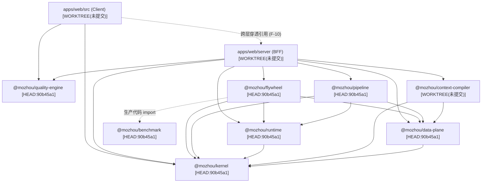
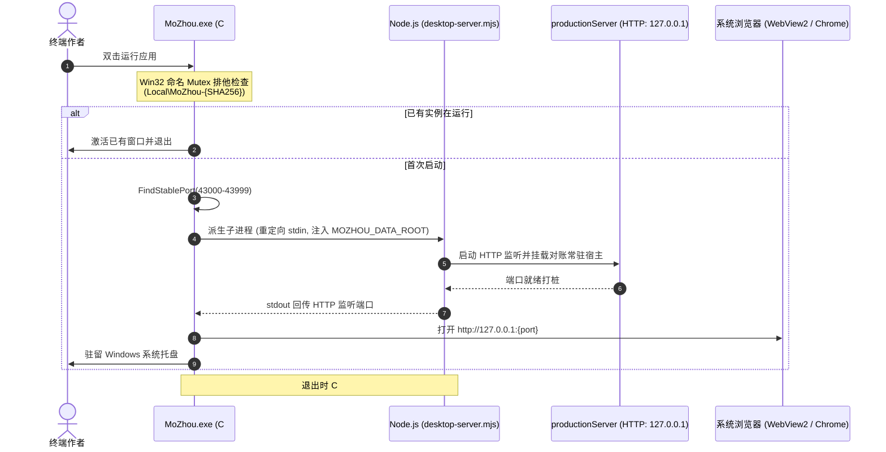

# 墨舟 (MoZhou / Novel OS) 模块架构总审计报告
# (FINAL-REPORT.md)

> **审计标识**：`audit-2026-10-03`  
> **基线提交**：`HEAD:90b45a1a1bf15a97b1cc690ad0b9872018aeebcb` (短 `90b45a1`) · 分支 `feature/windows-local-release` (ahead 7)  
> **运行环境**：Node.js v24.18.0 / Windows 11 专业工作站版 10.0.26200 x64 / pnpm 9.15.0 / Git 2.55.0  
> **运行单元版本事实**：`dist-server` 与 Vite 运行的均为工作区未提交活代码（42 项改动），因此所有触及未提交路径的结论均同时标明 `HEAD:90b45a1` 与 `WORKTREE(未提交)` 双版本行号  
> **交付物对应**：汇总 `01` 基线、`02` 边界、`03` 作者路径、`04` 接口契约、`05` 争议纠错、`06` 隔离实测、`07` 交叉复核全部成果  
> **主笔**：module-mapper-2 (全团队综合) · 审计日期：2026-10-03  

---

## Executive Summary (高管摘要：开头直接回答)

### 1. 当前到底有哪些模块与子系统？
MoZhou **并非只有历史报告声称的 9 个模块，而是由 14 个具备独立职责边界、执行上下文或发布形态的架构单元组成**：
- **Packages 基础与领域核心包 (8个)**：`@mozhou/kernel` (领域类型基石)、`@mozhou/quality-engine` (规则与De-AI)、`@mozhou/data-plane` (本地优先存储与SQLite投影)、`@mozhou/context-compiler` (三通道检索与凭证)、`@mozhou/pipeline` (十步长篇状态机与2PC编排)、`@mozhou/runtime` (模型供应商与事件总线)、`@mozhou/flywheel` (文风偏好学习器)、`@mozhou/benchmark` (六指标机械评估与夹具)。
- **Web 应用双端总成 (2个)**：`web-client` (`apps/web/src` React 18 前端 SPA)、`bff-server` (`apps/web/server` Node.js 本地微服务)。
- **桌面运行宿主与启动器 (4个)**：`tauri-host` (`src-tauri` 仅 12 行 Rust 空壳)、`desktop-launcher` (`MoZhou.cs` + `desktop-server.mjs` 真实 Windows 商业宿主编排者)、`cli-launcher` (`scripts/launcher.mjs` 开发与通用 CLI)、`installer-lifecycle` (`installer.iss` 安装与升级生命周期规约)。

### 2. 哪些边界已证实合理？
- **本地优先（Local-First）正典数据权威性**：物理 Markdown 文件（`正文/第一卷/第NN章.md`）与纯文本 JSONL 流（`追踪/*.jsonl`、`.mozhou/events.jsonl`）作为不可变真源的设计极其扎实；
- **从属可丢弃 SQLite 投影机制**：正文 Markdown 文本 100% 不入 SQLite 数据库；`.mozhou/runtime.sqlite` 丢失或坏损时，通过 `rebuildProjectionFromCanon` 可 100% 确定性幂等自愈重建（实测 `probe-11` 证实）；
- **上下文凭证物理不可变性**：`.mozhou/receipts/rcpt_<ULID>.json` 贯彻“一证一文件不可变（INV-R2）”契约，审查质检基于真实凭证锚点，拒绝虚构凭证；
- **全链路 CAS 乐观并发防护**：保存草稿、采纳候选、撤销采纳与定稿提交均强制携带 `expectedRevision`，杜绝单机多窗口静默覆盖；
- **De-AI 浏览器端安全解耦**：`@mozhou/quality-engine/de-ai` 提供纯浏览器安全子路径导出，成功剔除 Node 物理依赖供前端实时遥测消费。

### 3. 哪些边界存在已证实问题？
- **2PC 提交恢复前滚二次中断致正典追踪流永久静默丢失 (F-01, CRITICAL)**：实测确证 `recoverForward` 截断后若遭遇二次断电，重启将误判为 `untouched`，直接删除预写日志宣布恢复成功，导致追踪流增量永久丢失；
- **数据根进程独占锁 PID 复用引发假死死锁 (F-02, CRITICAL)**：依赖脆弱的 `process.kill(pid, 0)`，异常退出后若 PID 被系统复用分配给无关存活进程，系统将永久抛 `DATA_ROOT_LOCKED` 拒绝启动；
- **原子写临时文件命名固定导致并发践踏 (F-03, HIGH)**：`atomicWriteFileSync` 使用固定后缀 `.mozhou-tmp`，并发写同一文件发生数据覆盖破坏与文件锁异常；
- **核心正文写路径漏走内存互斥锁 (F-04, HIGH)**：核心路由 `proseRoutes.ts`（草稿保存与定稿提交）完全未接入 `BookOperationQueue.withBookLock`；
- **跨层代码穿透 (F-10, MEDIUM)**：前端 `apps/web/src/public/PublicSite.tsx` 跨层直接引用服务端 `billingCatalog` 单例。

### 4. 哪些关键结论仍无法判断？
- **掉电耐久性与断电不丢稿**：全仓均为应用层软件抛 Error 模拟断言，**缺乏物理硬件真实断电、拔盘与掉电刷盘实测数据（标为 NOT RUN）**；
- **真实长篇 50 章连载能力**：50 章基准确证为静态 JSON 夹具，真实模型端到端推步能力未验证；
- **商业微信/支付宝回调支付**：后端恒定返回 `mock_checkout` 虚拟 URL，真实商户号公网异步回调未验证。

### 5. 最先需要处理的风险是什么？
必须立即启动热修复收敛前述三大致命与高危缺陷：**修复 2PC 二次恢复丢数据逻辑 (F-01)**、**以进程启动签名与 Win32 命名 Mutex 替换 PID 锁 (F-02)**、**将原子写临时文件名唯一化并在 proseRoutes 补齐内存锁 (F-03, F-04)**。

---

## 一、 实际模块与运行单元全量清单 (14 架构实体)

```
+---------------------------------------------------------------------------------------------------+
|                                     MoZhou / Novel OS (14 架构单元)                                 |
+------------------------------------+----------------------------------+---------------------------+
| 基础设施与领域核心 (Packages)         | 运行应用总成 (Apps)               | 宿主与启动编排 (Hosts)    |
| - @mozhou/kernel                  | - apps/web/src (Web Client SPA)  | - src-tauri (12行空壳)    |
| - @mozhou/quality-engine          | - apps/web/server (BFF Server)   | - MoZhou.cs (真实C#宿主)  |
| - @mozhou/data-plane              |                                  | - desktop-server.mjs      |
| - @mozhou/context-compiler        |                                  | - scripts/launcher.mjs    |
| - @mozhou/pipeline                |                                  | - installer.iss (安装规约)|
| - @mozhou/runtime                 |                                  |                           |
| - @mozhou/flywheel                |                                  |                           |
| - @mozhou/benchmark               |                                  |                           |
+------------------------------------+----------------------------------+---------------------------+
```

全量 14 单元清点矩阵已详细收录于 `audit-2026-10-03/02-module-inventory-and-boundaries.md` 第一章。

---

## 二、 架构三图与深度技术剖析

### 2.1 图一：源码依赖图 (Source Dependency Graph)
> **独立图文件**：`audit-2026-10-03/figs/01-source-dependency-graph.mmd`  
> **关键纠错**：推翻原报告遗漏依赖边的错误，补齐 `flywheel -> benchmark`、`web-client -> billingCatalog` 跨层穿透边，纠正 `quality-engine` 零依赖真实拓扑。



---

### 2.2 图二：运行图 (Runtime Process & Execution Graph)
> **独立图文件**：`audit-2026-10-03/figs/02-runtime-process-graph.mmd`  
> **关键发现**：Tauri 纯属空壳；C# 启动器（`MoZhou.exe`）通过 Win32 命名 Mutex 实现防多开，通过私有匿名 stdin 管道向 Node 子进程发送 `shutdown` 指令实现优雅下线。



---

### 2.3 图三：数据所有权图 (Data Ownership & Persistence Graph)
> **独立图文件**：`audit-2026-10-03/figs/03-data-ownership-graph.mmd`  
> **关键纠错与裁决**：纠正 02 报告关于路径的臆造；确立正典文件为唯一真源，SQLite 纯属可随时丢弃重建的从属投影。

```mermaid
graph LR
  subgraph Client [客户端浏览器所有权]
    LS["window.localStorage<br/>mozhou.draft.cache.* (未保存编辑)<br/>mozhou.candidate.cache.* (候选暂存)"]
  end

  subgraph BookCanon [每本书正典真源 (不可变主源)]
    ProseMD["正文/第一卷/第NN章.md<br/>(Markdown + YAML Frontmatter)"]
    TrackingJSONL["追踪/*.jsonl<br/>(五族事实增量流)"]
    EventsJSONL[".mozhou/events.jsonl<br/>(不可变领域审计账本)"]
    ReceiptsJSON[".mozhou/receipts/rcpt_*.json<br/>(不可变装配凭证 INV-R2)"]
    StyleMD["文风.md<br/>(I1 受控豁免画像)"]
  end

  subgraph BookProjection [每本书从属投影 (可随时无损重建)]
    RuntimeDB[".mozhou/runtime.sqlite<br/>(只读投影：大纲/实体/追踪行)<br/>*正文不入库*"]
    UsageJSONL[".mozhou/usage.jsonl<br/>(运行时用量投影)"]
  end

  subgraph GlobalData [全局数据根所有权]
    BillingDB["dataRoot/billing.sqlite<br/>(独立全局订单与权益)"]
    LockFile["dataRoot/.mozhou_instance.lock<br/>(进程排他锁)"]
  end

  ProseMD -->|"rebuildProjectionFromCanon"| RuntimeDB
  TrackingJSONL -->|"全量重放"| RuntimeDB
```

---

## 三、 七个必答问题逐一严谨回答

### Q1. 系统的真实模块边界与依赖拓扑到底是什么？
**回答**：系统实际由 14 个架构实体构成。核心拓扑呈现从底层纯数学/类型包（`kernel`、`quality-engine`）到存储包（`data-plane`）、编译与编排包（`context-compiler`、`pipeline`）、再到服务总成（`bff-server`）与前端（`web-client`）的清晰分层。依赖图经 `gitnexus check --cycles` 实测通过（0 循环依赖）。但存在 **1 处已证实的跨层穿透**：`web-client` 绕过 BFF 协议层直接 `import` 服务端 `billingCatalog` 单例。

### Q2. 真实作者全路径中，数据究竟何时、何地、以何种顺序落盘？
**回答**：
- **编辑时**：数据仅存在于前端 React 内存与 `localStorage['mozhou.draft.cache']`，服务端磁盘零写入；
- **保存草稿时**：服务端 `saveProseDraft` 通过 `atomicReplace` 原子重命名写入 `正文/第一卷/第NN章.md` 并刷新 `manifest.json`，**物理落盘完成后才返回 HTTP 200**；
- **定稿提交时**：严格遵循 2PC 顺序：写 `.mozhou/pending_commit.json` 预写日志 -> 追加 `追踪/*.jsonl` -> 追加 `events.jsonl` -> **原子重命名翻转正文相位为 committed（线性化点）** -> 写入 SQLite 投影 -> 刷新 manifest 并删除预写日志。8 个物理写盘步骤全数成功后才响应 HTTP 200。**不存在虚假成功窗口**。

### Q3. 八类状态在代码实现与物理存储中分别归属于谁？
**回答**：
1. **作者未保存编辑**：归浏览器客户端（`localStorage`），受 `beforeunload` 保护；
2. **已保存草稿**：归服务端 Canon 物理 markdown 文件，受 CAS 乐观锁保护；
3. **AI 候选与半稿**：归服务端 `.mozhou/candidates/<id>.json`，断流截断自动保留为 partial，不污染正文；
4. **已采纳正文**：经 2PC `intent.json` 事务写入正文草稿，撤销绑定 CAS 保护；
5. **已提交正典**：`phase: committed` 正文与 `追踪/*.jsonl`，不可变历史里程碑，受定稿锁保护；
6. **SQLite 投影**：从属可丢弃投影，正文文本完全不入库，坏损可 100% 幂等自愈重建；
7. **上下文/索引/文风画像**：Receipt 凭证一证一文件不可变；`文风.md` 受 I1 豁免由飞轮单口更新；索引懒加载；
8. **任务账本与费用记录**：账本与用量独占各书运行时区；订单与权益独占全局 `billing.sqlite`。

### Q4. 关键操作的行为语义契约是否健全？
**回答**：在单机单实例正文防丢方面健全（具备 CAS 乐观锁、写前哈希防外部篡改、2PC 预写日志、防空章导出守卫）。但存在 **3 大认知偷换与破绽**：
1. `expectedRevision` 仅提供了 CAS 冲突检测，被误传为“完整幂等”（重复提交返回 409 报错而非幂等成功）；
2. 2PC 提交恢复存在二次中断丢数据缺陷（F-01）；
3. 商业支付目前恒定返回 `mock_checkout` 虚拟地址，属于未接入真实渠道的原型状态。

### Q5. 上一份报告中的 11 项争议点，哪些成立、哪些失实？
**回答**：
- **成立/部分成立 (8项)**：锁安全（部分成立，确证漏锁与 PID 复用死锁）、原子写入（部分成立，确证文件名固定与无真实掉电实测）、双平面 2PC（部分成立，确证二次中断丢数据）、提交重试（部分成立，确证 409 非真幂等与大模型重复计费）、确定性（部分成立，确证存在 ULID/时间戳/ONNX 浮点不确定性）、benchmark（部分成立，确证 50 章为静态夹具但生产代码有依赖）、测试真实性（部分成立，确证 1825 总数属实但分类存在凑数失误）、安全与发布（部分成立，确证无签名无混淆但误报 body 限制）。
- **完全不成立/失实辟谣 (3项)**：
  1. **SQLite timeout=0 辟谣**：better-sqlite3 默认构造参数显式为 5000ms（实测并发等待 5.5s 抛 busy 证实）；
  2. **WAL synchronous 辟谣**：实测 WAL 模式下默认 synchronous 依然是 2 (FULL)；
  3. **架构边界失实**：context-compiler 真实写回执（非纯内存），runtime 与数据平面大量裸调用 `appendFileSync`（未收敛原子写）。

### Q6. 隔离环境的故障注入与一致性验证得出了哪些真实结论？
**回答**：11 项隔离实测中：同章竞争保存完全防丢（P02）、晚到生成结果完全隔离（P04）、采纳撤销单调前移一致（P05）、导出 DOCX 逐字严格对齐（P10）、旧版 SQLite 投影 100% 自愈重建（P11）。但同时**实测捕获两大杀手级 Bug**：PID 复用引发进程锁假死死锁（P03）、2PC 提交恢复前滚二次中断致正典增量永久静默丢失（P07）。

### Q7. 针对当前系统的实际架构状态，应给出怎样的发布与演进判断？
**回答**：必须严格区分三个不同产品形态与范围，**严禁混为一谈**：
1. **单机本地技术预览原型 (Technical Preview)**：**【PASS / 可以发布】**。在本地单作者单实例使用场景下，防御性极高，单次故障可自愈，完全满足体验与开发评估；
2. **面向普通终端用户的正式桌面版 (Desktop GA)**：**【FAIL / 暂不批准发布】**。必须先修复 PID 死锁 (F-02)、2PC 二次中断 (F-01)，并补齐代码签名证书消除 SmartScreen 蓝色拦截；
3. **商业多租户在线付费服务 (Commercial Hosted SaaS)**：**【BLOCK / 绝不可发布】**。多实例并发必踩锁、无分布式事务协调、大模型调用重试无去重、支付仅为虚拟 mock。当前代码属于本地优先架构，多租户、云同步与插件系统目前并非必要，强行将其推向商用 SaaS 将引发灾难性故障。

---

## 四、 逐模块边界证据卡摘要表

| 单元 | 模块标识 | 来源标签 | 核心定位文件与行号 | 保证强度 | 边界风险与图谱说明 |
|:---:|---|:---:|---|:---:|---|
| U01 | `@mozhou/kernel` | `HEAD:90b45a1` | `kernel-schema.ts:1-120`<br/>`ulid.ts:1-40` | **强** | 纯内存零依赖；工作区新增 `ChannelContribution`。 |
| U02 | `@mozhou/quality-engine` | `HEAD:90b45a1` | `rules/index.ts:1-80`<br/>`de-ai/index.ts:1-60` | **强** | 具备浏览器安全子路径导出，被客户端安全消费。 |
| U03 | `@mozhou/data-plane` | `HEAD:90b45a1` | `chapter.ts:320,569,805`<br/>`local-data-plane.ts:451` | **中** | 发现 F-01 二次恢复丢数据缺陷；未做目录 fsync。 |
| U04 | `@mozhou/context-compiler` | `WORKTREE(未提交)` | `assemble.ts:399-720`<br/>`receipt-file.ts:184` | **强** | 真实写物理回执；工作区包含 `summarizeByChannel`。 |
| U05 | `@mozhou/pipeline` | `HEAD:90b45a1` | `commit-orchestration.ts:191`<br/>`draft-accept.ts:184` | **强** | 意图文件 2PC 真幂等；大模型重试无去重。 |
| U06 | `@mozhou/runtime` | `HEAD:90b45a1` | `eventBus.ts:108`<br/>`engine.ts:1-90` | **中** | 裸 `appendFileSync` 写账本；半截 JSON 行静默丢弃。 |
| U07 | `@mozhou/flywheel` | `HEAD:90b45a1` | `style-store.ts:1-80`<br/>`evaluator/project.ts:23` | **强** | I1 豁免单口写入 `文风.md`；依赖 benchmark 判定器。 |
| U08 | `@mozhou/benchmark` | `HEAD:90b45a1` | `metrics.ts:1-70`<br/>`run.ts:1-90` | **强** | 生产零 JS 运行时依赖；50 章测试确为静态夹具。 |
| U09 | `web-client` | `WORKTREE(未提交)` | `App.tsx:162-245`<br/>`ProseEditorPanel.tsx:45` | **中** | 发现 F-10 跨层穿透引用服务端 `billingCatalog`。 |
| U10 | `bff-server` | `WORKTREE(未提交)` | `router.ts:85`<br/>`bookAccess.ts:51,101` | **中** | 证实 1MB body limit；发现 F-02 PID 锁死锁与 F-04 漏锁。 |
| U11 | `tauri-host` | `HEAD:90b45a1` | `src-tauri/src/main.rs:1-12` | **无** | 12 行空壳代码，图谱未覆盖（Rust）。 |
| U12 | `desktop-launcher` | `HEAD:90b45a1` | `scripts/release/windows/MoZhou.cs:38`<br/>`desktop-server.mjs:1-50` | **强** | 真实 Windows 桌面总编排者，Win32 Mutex 互斥。 |
| U13 | `cli-launcher` | `HEAD:90b45a1` | `scripts/launcher.mjs:1-80` | **中** | 通用启动器，按需拉起活工作区代码。 |
| U14 | `installer-lifecycle` | `HEAD:90b45a1` | `scripts/release/windows/installer.iss:1-90` | **中** | Inno Setup 安装包规约，发布缺少代码签名 (F-06)。 |

---

## 五、 发布决策与成熟度判定 (Go/No-Go Verdict)

### 综合成熟度定性：
**墨舟 (MoZhou / Novel OS) 当前是一款「工程规范度与防御性极高的本地优先技术原型 / 预览版 (Technical Preview)」。**

### 三级准入发布裁决：
1. **形态 A：本地开发者与极客技术预览 (Local Technical Preview)** -> **【APPROVED (批准)】**
   - 理由：本地单人单实例使用场景下，核心正文防丢能力与投影自愈能力卓越，已知缺陷在单人正常操作中极难触发。
2. **形态 B：普通大众作者 Windows 桌面安装版 (Desktop GA)** -> **【CONDITIONALLY BLOCKED (条件阻断)】**
   - 解除阻断条件：必须先完成 `NEXT-ROUND-INPUT.md` 列出的 Top 3 热修复，并在 CI 中配置数字签名证书消除 SmartScreen 拦截。
3. **形态 C：商业在线多租户 SaaS 服务 (Commercial SaaS)** -> **【HARD BLOCKED (严禁发布)】**
   - 理由：全系统从文件锁、单机队列到虚拟 Mock 支付，底层完全是本地单机优先设计，当前架构绝不具备支撑多租户高并发商业运营的能力。
