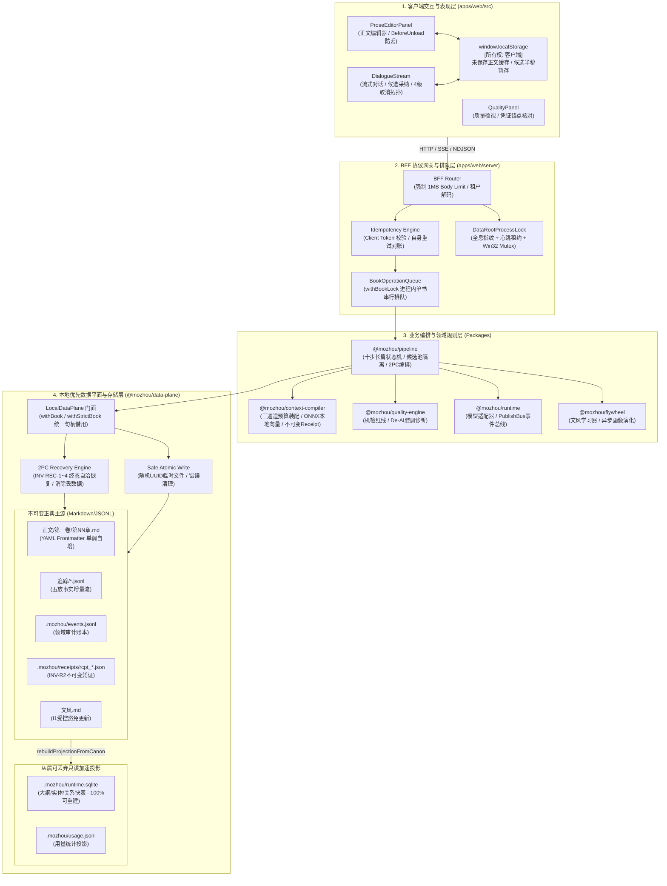

# 墨舟 (MoZhou / Novel OS) 技术规格说明书
# 阶段四：业务/运行/代码三层边界裁决与重构蓝图综合
# (NEXT-ROUND-04-ARCHITECTURE-BLUEPRINT.md)

> **文档属性**：系统重构蓝图与三层架构边界终审规范 (Master Architecture Blueprint & Specification)  
> **基线版本**：HEAD `90b45a1a1bf15a97b1cc690ad0b9872018aeebcb` / WORKTREE(42项未提交改动)  
> **编制依据**：
> - `audit-2026-10-03` 全量审计成果（01 基线、02 边界证据、03 作者路径、04 接口契约、05 争议纠错、06 隔离实测、07 交叉复核）
> - 演进设计阶段规约：`NEXT-ROUND-01-RECOVERY-SAFETY.md`（阶段一：恢复安全模型）、`NEXT-ROUND-02-CONCURRENCY-OWNERSHIP.md`（阶段二：并发与写入所有权）、`NEXT-ROUND-03-RETRY-CANCELLATION.md`（阶段三：真幂等与取消规范）  
> **主笔**：module-mapper-2 (模块测绘与架构总成) · 审定日期：2026-10-03  

---

## 目录

1. [一、 边界裁决哲学与四大复核校正原则](#一-边界裁决哲学与四大复核校正原则)
2. [二、 业务边界裁决：职责内聚与变化隔离](#二-业务边界裁决职责内聚与变化隔离)
3. [三、 运行边界裁决：进程模型、故障隔离与运行拓扑](#三-运行边界裁决进程模型故障隔离与运行拓扑)
4. [四、 代码边界裁决：包规划、目录划分与接口契约](#四-代码边界裁决包规划目录划分与接口契约)
5. [五、 本地优先持久化基线定性与演进策略](#五-本地优先持久化基线定性与演进策略)
6. [六、 架构重构综合蓝图（总体拓扑架构图）](#六-架构重构综合蓝图总体拓扑架构图)
7. [七、 四阶段实施与迁移落地计划](#七-四阶段实施与迁移落地计划)
8. [八、 演进防腐纪律与验收准入标准](#八-演进防腐纪律与验收准入标准)

---

## 一、 边界裁决哲学与四大复核校正原则

在深入重构设计之前，必须基于 `07-crosscheck-review.md` 的对抗式复核结论与工程常识，确立四大核心校正原则，坚决防止教条主义与盲目重构：

### 1. 坚决纠正“14 个实体 = 14 个包”的统计口径错误，严禁机械拆包
- **事实澄清**：清点报告 `02-module-inventory-and-boundaries.md` 识别出的“14 个架构实体”，涵盖了 **8 个 NPM 包、2 个应用级总成目录（`apps/web/src` 与 `apps/web/server`）、以及 4 个宿主/打包/脚本实体（`src-tauri`、`MoZhou.cs`、`scripts/launcher.mjs`、`installer.iss`）**。
- **裁决红线**：架构实体的多样性反映了实际发布与运行形态的复杂性，**绝对不等于要把代码库机械拆分成 14 个独立的 npm workspace 包**！盲目按实体拆包会导致包间接口爆炸、符号循环依赖加剧、版本发包维护成本剧增。代码分包必须基于明确的“代码隔离、独立构建与复用需求”，能够通过包内目录收敛的绝不新建独立包。

### 2. 澄清代码边界越界性质：前端引用 billingCatalog 系工程规范越界，非机密泄露
- **事实澄清**：`apps/web/src/public/PublicSite.tsx:12` 直接导入 `apps/web/server/billing/catalog.ts` 中的 `billingCatalog`。
- **严谨定性**：`billingCatalog` 包含的是纯静态商品计划（套餐名称、原价、现价分、Token 额度），其中**零敏感密钥、零商户私钥、零数据库写权限**。在纯静态展示层面打包进客户端并不会引发安全漏洞。
- **真正问题**：该问题的实质是**前后端分层工程边界的破损（Layering Inversion）**，导致前端直接感知了服务端 internal 目录结构。正确的做法是将套餐契约类型（Type Contract）收敛到共享领域层，前端通过标准 HTTP API 动态获取或消费共享契约，而非渲染层直接抓取服务端实现文件。

### 3. 不将现有 Markdown/SQLite 绝对化为不可动摇的宗教教条
- **事实澄清**：当前墨舟采用“纯文本 Markdown/JSONL 正典 + 本地只读 SQLite 投影”的双平面模型。
- **演进定性**：双平面设计在本地单机离线、作者主权（纯文本永久可读、便于 Git/网盘备份）、防数据损坏方面展现出极高的防御性。但这**是当前产品定位（本地技术预览 / 桌面单机创作者）下的最优工程基线，而非放之四海皆准的宗教教条**。
- **演进策略**：重构方案承认并坚守当前的“正典 Markdown 唯一真源，SQLite 随时可丢弃自愈重建”基线，在此基线上做实并发安全与恢复自洽；同时保持接口契约的抽象度，使系统未来在演进到真正的多端云同步或协作引擎时，数据平面有平滑升级的退路。

### 4. 严禁为了“迎合架构图对称好看”而虚构抽象层
- 所有重构项必须直接对应已证实的问题（F-01 丢数据、F-02 PID 假死、F-03 临时文件踩踏、F-04 漏锁、F-05 伪幂等），拒绝未经推演的大规模通用性重写。

---

## 二、 业务边界裁决：职责内聚与变化隔离

业务边界解决的核心问题是：**哪些规则和数据天然属于同一个业务领域（应当内聚），哪些能力因为变化频率、业务生命周期和驱动源的不同而必须严格分开？**

```
+---------------------------------------------------------------------------------------------------+
|                                       业务边界裁决全景图                                            |
+-----------------------------------+-----------------------------------+---------------------------+
| 1. 正典创作域 (Canon Creation)      | 2. 知识与上下文编译域 (Retrieval)   | 3. 会话与智能生成域 (AI)   |
| - 正文编辑与版本状态机 (草稿/定稿)     | - 设定/大纲/实体卡片管理            | - 长篇十步驱动状态机       |
| - 单书正典文件写入 (I/O 权威)        | - 三通道动态预算召回 (Token Budget)  | - 大模型流式输出与取消隔离 |
| - 两阶段提交预写日志 (2PC Engine)  | - 不可变装配凭证 (ContextReceipt)  | - 候选草稿池与半稿保护     |
| [变化原因: 创作者交互、防丢与落盘保证]  | [变化原因: 提示词工程、检索召回策略] | [变化原因: 模型供应商协议] |
+-----------------------------------+-----------------------------------+---------------------------+
| 4. 质量审查与度量域 (Quality Gate)| 5. 风格画像与飞轮学习域 (Learning)| 6. 账户与商业化履约域     |
| - 机械质量红线 (字数/复读率/违禁词)| - 场景风格统计与学习更新机制        | - 设备码认证与安全会话    |
| - 真实上下文编译凭证锚点核对       | - 文风画像结构化维护 (文风.md)     | - 套餐目录与订阅履约状态机|
| [变化原因: 平台内容安全与质检算法] | [变化原因: 创作者个人风格演化算法]  | [变化原因: 商业定价/支付] |
+-----------------------------------+-----------------------------------+---------------------------+
```

### 1. 业务域详细切分与变化隔离规则

#### A. 正典创作与持久化核心域 (Canon Creation & Persistence Domain)
- **核心职责**：管理小说正文的物理生命周期（草稿编辑、原子落盘、版本升级、定稿 2PC 事务、历史重建自愈）。
- **变化驱动**：作者人机交互习惯、本地文件存储规范、防丢稿耐久性保障。
- **隔离规则**：
  - 本域是全系统的**底层权威主源（Single Source of Truth）**，只对物理文件和数据完整性负责；
  - 严禁逆向依赖上层业务模型：正典层绝不感知大模型是 OpenAI 还是 Claude，绝不包含商业计费逻辑；
  - 状态所有权闭环：正文 Markdown 文件（`正文/第一卷/第NN章.md`）和追踪流（`追踪/*.jsonl`）的写权限**完全由该域独占，禁止任何其他业务模块越权直写物理磁盘**。

#### B. 设定知识与上下文编译域 (Knowledge & Context Assembly Domain)
- **核心职责**：管理世界观设定（人物、物品、势力、地理卡片）、大纲层级结构；在生成前根据当前创作现场，通过关键词、图谱关联、向量嵌入三通道执行预算裁切，产出装配好的提示词包和不可变凭证。
- **变化驱动**：提示词工程演进、RAG 召回算法调优、Token 预算分配策略。
- **隔离规则**：
  - 凭证不可变性：产出的 `ContextReceipt` 遵循 INV-R2 物理不可变原则，一经生成即归档，不随正典的修改而更新；
  - 与正典域单向解耦：上下文编译域只读读取正典设定，其输出为只读数据包，绝不直接反写正典文件。

#### C. 会话流程与智能生成域 (Session & AI Generation Domain)
- **核心职责**：编排长篇创作的十步驱动状态机（准备、大纲、选卡、草稿、审阅等）；管理与大模型的交互会话，维护流式连接，管理生成候选池（`Candidate Pool`）与断流半稿。
- **变化驱动**：外部大模型 API 协议变更、流式传输协议调整、创作工作流步骤扩展。
- **隔离规则**：
  - 候选与正典严格隔离：AI 生成的未确认文本仅存放在候选池（`.mozhou/candidates/` 或独立候选表），**未获得作者显式采纳动作（`draft.accept`）前，严禁修改任何正文 Markdown 文件**；
  - 取消语义隔离：大模型的网络取消（Abort）必须被限制在网络层和候选状态机内，不得污染正典写入锁。

#### D. 质量审查与度量域 (Quality Evaluation Domain)
- **核心职责**：对章节正文进行机械级与语义级规则核验（字数合规、4-gram 循环复读率检测、Tier1 违禁词过滤、AI 味诊断）。
- **变化驱动**：小说质量规范变更、平台合规词库升级、读者体验评估标准变化。
- **隔离规则**：
  - 纯计算与只读属性：质检引擎只接收只读正文文本与上下文凭证引用，其评估结果独立持久化为质量报告（`.mozhou/quality_reports/`），绝不直接改动正文。

#### E. 风格画像与飞轮学习域 (Style Learning & Flywheel Domain)
- **核心职责**：在章节提交后，订阅提交收尾事件，异步比对作者改写前后的差异（Delta），统计对话比、句长分布、感官描写密度，增量更新该作品的四场景文风画像（`文风.md`）。
- **变化驱动**：文风统计模型演进、作者画像参数调整。
- **隔离规则**：
  - 学习失败不阻断正典：风格画像是派生增量，其学习失败属于软降级，绝不能导致定稿提交操作失败回滚。

#### F. 商业化、账户与订阅履约域 (Billing, Auth & Entitlements Domain)
- **核心职责**：设备码登录、会话安全维持、商品套餐发布、支付订单生成与履约、会员权益状态机维护。
- **变化驱动**：商业定价策略、支付渠道接入（微信/支付宝/Stripe）、会员权益规则。
- **隔离规则**：
  - 作用域隔离：属于全局应用级服务（`dataRoot/billing.sqlite`），与各单本小说的内容仓库（Book Repo）物理隔离；
  - 绝对禁止业务穿透：小说创作核心管线绝不允许直接读写订单库，仅能在生成前通过轻量契约查询“当前用户是否具备生成配额”。

---

## 三、 运行边界裁决：进程模型、故障隔离与运行拓扑

运行边界解决的核心问题是：**哪些能力必须独立进程、独立权限或独立生命周期？哪些能力留在同一进程即可？如何以最小的运维复杂度保证系统的高可用与优雅下线？**

```
+---------------------------------------------------------------------------------------------------+
|                                      系统运行拓扑与进程模型                                         |
+---------------------------------------------------------------------------------------------------+
|  [OS 桌面外壳层] (Native GUI Process)                                                             |
|  - 实体: MoZhou.exe (Windows C# Launcher / 未来 macOS Native App)                                 |
|  - 职责: 监听单实例命名互斥体 (Named Mutex)、系统托盘图标、派生/管理 Node 子进程、唤醒系统浏览器     |
+----------------------------------+----------------------------------------------------------------+
                                   | 进程派生 (IPC 管道重定向: stdin/stdout/stderr)
+----------------------------------v----------------------------------------------------------------+
|  [服务端核心工作进程] (Node.js Core Service Process)                                               |
|  - 实体: desktop-server.mjs -> apps/web/server/productionServer.ts                                |
|  - 监听: HTTP 本地回环 (127.0.0.1:43xxx)                                                          |
|  - 状态: 持有数据根排他锁 (DataRootLock)、持有常驻对账服务 (ReconciliationRuntime)                  |
|  - 模块驻留: @mozhou/data-plane, context-compiler (ONNX), pipeline, runtime                       |
+----------------------------------+----------------------------------------------------------------+
                                   | 本地 HTTP / Server-Sent Events / NDJSON 流式连接
+----------------------------------v----------------------------------------------------------------+
|  [渲染与交互进程] (Browser / WebView2 UI Process)                                                 |
|  - 实体: 系统浏览器 (Edge/Chrome) 或轻量 WebView2 宿主窗口                                        |
|  - 状态: 浏览器内存 (React 18 Component Tree)、本地暂存 (window.localStorage)                    |
|  - 职责: 呈现正文编辑器、De-AI 前端实时遥测、执行 beforeunload 防丢拦截                           |
+---------------------------------------------------------------------------------------------------+
```

### 1. 进程划分裁决

#### 裁决 1：维持“单一 Node.js 核心服务进程”为主体，严禁盲目搞微服务化
- **决策依据**：墨舟定位为**本地优先（Local-First）桌面写作工具**。单进程模型具有极低的内存开销（100MB 左右）、零跨进程通信（IPC）序列化开销、以及近乎于零的部署运维复杂度。
- **归属收敛**：数据平面（`data-plane`）、上下文编译（`context-compiler`）、长篇编排（`pipeline`）、质量规则（`quality-engine`）、BFF 路由全部驻留在同一个 Node.js 核心进程中运行。各业务模块之间通过清晰的内部函数调用或内存事件总线交互，坚决不引入 RPC 框架或独立微服务。

#### 裁决 2：Native 宿主与 Node 核心进程的生命周期解耦（C# 托管启动器）
- **决策依据**：Windows 平台对于“开机启动、系统托盘最小化、单实例防重开、端口自动协商”有强烈的原生 OS 级要求，纯 Node.js 脚本无法优雅处理 Windows 消息循环和异常退出。
- **交互规范**：
  1. `MoZhou.exe` 作为父进程，先通过 Win32 `Named Mutex` 确保单实例；随后派生 `node.exe desktop-server.mjs` 作为子进程，并建立**私有匿名 stdin 管道**；
  2. 端口动态协商：Node 子进程启动并在 `43000-43999` 范围内成功绑定端口后，通过 stdout 向父进程回传 `READY:43128`；父进程随后唤起系统浏览器；
  3. 优雅下线协议（Graceful Shutdown）：父进程关闭时向 Node stdin 发送 `shutdown\n`，Node 进程捕获后执行关闭 SQLite 连接、解除数据根锁、完成 WAL 检查点，最后退出；父进程等待最多 3000ms，超时才执行 Terminate 兜底强杀。

#### 裁决 3：彻底归档空壳 `src-tauri`，消除桌面架构双轨制
- **决策依据**：全量审计已确证 `src-tauri` 为仅 12 行的空壳代码，既不拉起服务端，也不承担业务逻辑，反而导致版本号分叉（0.2.0 vs 0.3.0）与构建混乱。
- **裁决行动**：正式弃用并归档 `src-tauri`，确立 `MoZhou.cs` + Inno Setup 为 Windows 官方发布形态；待未来需要构建跨平台（macOS/Linux）桌面安装包时，再基于完备的设计引入轻量原生外壳。

### 2. 故障隔离与并发访问限制
- **单实例独占数据根**：通过阶段二设计的“全息指纹 + 心跳租约”进程排他锁（`DataRootLock`），彻底禁止多个 Node 进程并发挂载同一个 `MOZHOU_DATA_ROOT`，从物理入口消灭多进程踩踏；
- **异步穿插锁（单书队列锁）**：在核心正文写路径（`proseRoutes.ts`）全面强制挂载 `withBookLock`，确保对于同一本书的长耗时异步流水线（如包含大模型调用的定稿提交）在进程内排队串行化执行。

---

## 四、 代码边界裁决：包规划、目录划分与接口契约

代码边界解决的核心问题是：**哪些能力值得独立成 NPM workspace 包？哪些能力用包内目录（internal directories）和导出点（exports）就足够？如何治理依赖穿透？**

### 1. 现存 8 个包的精简与裁决矩阵

| 当前包名 | 裁决意见 | 理由与调整说明 |
|---|:---:|---|
| `@mozhou/kernel` | **保留** | 纯领域核心、九柱类型定义、错误基类与 ULID 生成，零外部依赖，作为全仓唯一契约基石。 |
| `@mozhou/quality-engine` | **保留并优化** | 核心机检算法包。维持其纯数学/正则属性；强化 `de-ai` 纯浏览器安全子路径导出，供前端安全直接引用。 |
| `@mozhou/data-plane` | **保留 (核心)** | 本地优先物理文件门面与 SQLite 投影引擎。收敛原子写入与两阶段提交，对外暴露严密的 `withBook` 借用 API。 |
| `@mozhou/context-compiler`| **保留** | 承担重量级检索装配、分词器与 ONNX 本地向量模型（24MB 二进制资产）。独立成包便于隔离重型依赖。 |
| `@mozhou/pipeline` | **保留** | 承载十步创作状态机、候选隔离、编排协调器与提案门面。上承路由，下合存储。 |
| `@mozhou/runtime` | **保留并收敛** | 统一管理模型供应商驱动、提示词配方装载与 `PublishBus` 内存审计事件总线。 |
| `@mozhou/flywheel` | **降级/合并评估** | 目前仅有文风学习器与评测指标。由于其生产代码依赖 `@mozhou/benchmark`，且业务规模较小，下一轮方案中**保持为独立包，但收敛其与 benchmark 的依赖倒置**。 |
| `@mozhou/benchmark` | **重新定性** | 本质是开发评测夹具与六指标算法。明确其为 `@mozhou/flywheel` 的下层度量工具包，剔除伪造的 50 章在线推步声称。 |

### 2. 代码边界治理要点

#### A. 彻底封堵跨层穿透引用 (Fix F-10)
- **现状违例**：`apps/web/src/public/PublicSite.tsx` 直接导入了 `apps/web/server/billing/catalog.ts`；
- **重构治理方案**：
  1. 将商业套餐的只读类型定义（`PlanSummary`, `PricingTier`）下沉至 `@mozhou/kernel` 或 `apps/web/src/contracts/billing.ts`；
  2. 前端组件绝不允许穿透引用服务端的实现单例 `billingCatalog`；
  3. 服务端通过暴露标准只读端点 `GET /api/billing/plans`（由 `billingRoutes.ts` 提供），前端通过异步 fetch 加载展示套餐，彻底阻断敏感实现代码被打入客户端 bundle。

#### B. 显式隔离包公共出口与内部实现 (Package Exports Discipline)
- 在所有 `packages/*/package.json` 中全面配置现代 `exports` 字段：
  ```json
  "exports": {
    ".": "./dist/index.js",
    "./de-ai": "./dist/de-ai.js"  // 显式白名单导出
  }
  ```
- 严禁调用方通过相对路径深层穿透导入未经导出的内部文件（如 `import ... from '@mozhou/data-plane/src/atomic-write.js'`），所有包间交互必须通过公共 API 入口收敛。

---

## 五、 本地优先持久化基线定性与演进策略

### 1. 现行本地优先持久化基线的客观定性
墨舟当前确立的持久化基线具有极高的工程价值：
- **纯文本正典第一原则 (Canon Markdown First)**：每一章均以规范的带有 YAML Frontmatter 的 Markdown 物理文件存储；叙事增量流以纯文本 JSONL 存储。即使墨舟软件在十年后不复存在，作者依然可以使用任意文本编辑器、Git 或 Obsidian 打开自己的作品，数据永生不灭；
- **SQLite 投影的从属性与免维护性**：SQLite 数据库不承载任何一手正文，纯粹作为大纲树、实体卡片全文检索、追踪事实关系图谱的**只读加速快表**。数据库损坏或版本升级时，系统不搞复杂的在线增量 migration，直接调用 `rebuildProjectionFromCanon` 在 1 秒内从 Markdown 正典重建。

### 2. 从“单机技术预览”向“未来云协作”演进的平滑策略
当前架构绝不将上述机制僵化为教条。系统通过抽象出的数据平面门面（`LocalDataPlane` 与 `withBook` 句柄借用模式），为未来的架构演进保留了平滑迁移路径：

```
                    +------------------------------------+
                    |        上层业务消费与管线编排        |
                    |    (Pipeline / Routes / UI)        |
                    +-----------------+------------------+
                                      | 统一门面借用接口 (withBook)
                    +-----------------v------------------+
                    |        DataPlane 存储抽象契约       |
                    +-----------------+------------------+
                                      |
         +----------------------------+----------------------------+
         | 当前实现 (Phase 1-4 基线)                                | 未来平滑扩展 (V2 远期设想)
+--------v----------------------------+                   +--------v----------------------------+
|  LocalDataPlane (本地物理文件模型)   |                   |  SyncDataPlane (云同步与协作引擎)    |
|  - 正典: 物理 Markdown / JSONL 文件 |                   |  - 正典: 本地 CRDT 块 / SQLite 统一存储|
|  - 投影: .mozhou/runtime.sqlite     |                   |  - 同步: 增量矢量时钟 / 端到端加密同步 |
|  - 事务: 本地 2PC Journal           |                   |  - 冲突: 分支自动合并 (Three-way merge)|
+-------------------------------------+                   +-------------------------------------+
```

- **演进承诺**：在当前的技术预览与桌面 GA 阶段，全力收敛并加固 `LocalDataPlane` 的 2PC 恢复自愈与单书并发锁，不提前引入过度复杂的分布式抽象；但业务层代码一律仅面向 `DataPlane` 接口编程，严禁散落直接操作物理文件系统 `fs` 的私有代码。

---

## 六、 架构重构综合蓝图（总体拓扑架构图）

本图综合前三阶段的设计不变量，清晰展现重构收敛后系统的**四层清晰拓扑、状态归属与安全交互边界**：



---

## 七、 四阶段实施与迁移落地计划

为确保下一轮方案在落地执行时具备极强的可操作性，整个实施计划划分为紧密衔接的四个阶段，**按风险优先级逐级推进，每阶段均设置不可动摇的验收门禁**：

```
+---------------------------------------------------------------------------------------------------+
|                                  四阶段演进实施路线图                                              |
+--------------------------+--------------------------+-------------------------+-------------------+
| 阶段一：崩溃与恢复安全性加固 | 阶段二：写入所有权与并发互斥 | 阶段三：接口真幂等与取消隔离 | 阶段四：边界收敛与发布准入|
| (P0: 根治数据损坏隐患)      | (P0: 根治死锁与文件冲突)   | (P1: 消除用户假冲突报警)   | (P2: 消除穿透与签名发布) |
| - 重构 recoverForward 算法| - 引入全息指纹+心跳租约锁  | - 引入 Client Token 机制 | - 消除 billing 跨层穿透  |
| - 消除二次中断丢数据缺陷    | - 补齐 proseRoutes 队列锁  | - 建立 409 自身对账协议   | - 归档 src-tauri 空壳     |
| - 落实 INV-REC-1~4 不变量 | - 临时文件名随机 UUID 化   | - 4 级取消拓扑与半稿保护   | - 配置 Windows 代码签名   |
| [工期: 2天]              | [工期: 2天]              | [工期: 3天]             | [工期: 2天]              |
+--------------------------+--------------------------+-------------------------+-------------------+
```

### 1. 阶段一：崩溃与恢复安全性加固 (Recovery Safety Hardening)
- **目标**：彻底消除 F-01 缺陷，重构 2PC 提交恢复引擎，实现真正的崩溃无损自愈。
- **具体实施项**：
  1. 重写 `packages/data-plane/src/chapter.ts` 中的 `recoverForward` 函数，废弃物理截断原文件的做法，改用盘面状态单调吸收算法；
  2. 实现不变量 INV-REC-1 至 INV-REC-4：在前滚恢复语境下，`'untouched'` 与 `'partial'` 统一作为重放目标，仅所有 target 均达到 `'done'` 终态时才允许调用 `unlinkSync` 删除预写日志；
  3. 修正事件流路径常量引用，统一为 `packages/data-plane/src/layout.ts` 定义的 `RUNTIME_EVENTS_PATH`。
- **阶段验收门禁**：运行 `logs/t5-probe-2pc-recovery-interrupt.mjs` 改编的自动化 Vitest 回归用例，在截断后再次注入崩溃强杀，二次重启后追踪流增量数据完整无缺（通过率 100%）。

### 2. 阶段二：写入所有权与并发排他互斥加固 (Ownership & Concurrency Guard)
- **目标**：消除 F-02（PID 假死死锁）、F-03（临时文件践踏）与 F-04（写路径漏锁）。
- **具体实施项**：
  1. 重写 `apps/web/server/bookAccess.ts` 中的 `DataRootProcessLock`：
     - 锁文件写入 JSON 格式指纹 `{ pid, instanceToken, startedAt, lastHeartbeatAt }`；
     - 引入 30 秒安全租约探测机制，在 Windows 下优先绑定 Win32 `Named Mutex`；
     - 创建文件严格采用原子排他标志 `'wx'`（`O_EXCL`）；
  2. 重构 `packages/data-plane/src/atomic-write.ts`：
     - 临时文件名修改为：`${absolutePath}.${randomUUID()}.tmp`；
     - 在 `try...finally` 块中增加异常物理清理逻辑，确保 I/O 失败时自动 `unlinkSync(tmp)`；
  3. 在 `apps/web/server/routes/proseRoutes.ts` 中，为 `/api/chapter.prose.save` 与 `/api/chapter.commit` 挂载 `defaultBookAccessManager.withBookLock` 串行排队。
- **阶段验收门禁**：
  - 探针 `probe-03` 重测通过：模拟残留 PID 为系统存活进程时，系统能凭借心跳租约过期与 Token 校验自动安全接管锁，零假死；
  - 并发压力测试：50 路并发调用草稿保存与提交，文件系统零 `EBUSY`，零临时文件泄漏。

### 3. 阶段三：接口真幂等重试、冲突消除与取消隔离 (True Idempotency & Cancellation)
- **目标**：消除 F-05（超时重试误判冲突）、完善定稿状态查询，建立 4 级全链路取消拓扑。
- **具体实施项**：
  1. 升级 `/api/chapter.prose.save`：
     - 接口支持可选的 `clientRequestId` 幂等令牌；
     - 服务端引入内存 LRU 缓存与正文哈希（`bodySha256`）比对机制；
     - 当盘面版本高于 `expectedRevision` 时，先校验盘面正文哈希是否等于请求体哈希。若相等，判定为网络超时重发，返回 HTTP 200 `{ ok: true, alreadyApplied: true, revision: ... }`，彻底消除前端红字假冲突报警；
  2. 新增对账查询端点 `POST /api/chapter.commit.status`：
     - 允许客户端在超时断流后携带 `chapterIndex` 与提交哈希安全查验提交结果，换取 `commitId`；
  3. 治理流式生成取消机制：
     - 统一 candidate 状态池与运行状态文件中的取消终态，消除 `cancelled` 与 `partial` 分裂；
     - 前端补齐半稿采纳显式确认交互（`confirmPartial: true`），盘活断流已有字数。
- **阶段验收门禁**：在网络丢包模拟用例中，客户端超时重试保存草稿 100% 成功返回 `alreadyApplied: true`，前端冲突弹窗触发率为 0。

### 4. 阶段四：代码边界收敛与发布准入就绪 (Boundary Clean-up & Release Gate)
- **目标**：收敛工程穿透违例，彻底完成 Windows 桌面版发布准入准备。
- **具体实施项**：
  1. 重构 `apps/web/src/public/PublicSite.tsx`，移除对 `apps/web/server/billing/catalog.ts` 的直接静态 `import`；通过共享契约包导出类型，前端统一走异步 API 获取套餐数据；
  2. 正式清理并归档 `src-tauri` 目录及相关脚本，在根目录 README 中澄清 Windows 正式桌面宿主为 `MoZhou.exe`（C# 托盘宿主）；
  3. 在 CI 发布构建流水线 `scripts/release/windows/build.mjs` 中接入代码签名脚本（`signtool sign`），配置受信任代码签名证书，并启用生产代码混淆压缩。
- **阶段验收门禁**：
  - 代码图谱与 ESLint 门禁检查无任何 cross-layer 逆向穿透；
  - 生成的 `MoZhou-Setup-0.3.0.exe` 在全新纯净 Windows 11 机器上运行，**零 SmartScreen 蓝色安全拦截警告，直接无缝唤醒工作台**。

---

## 八、 演进防腐纪律与验收准入标准

为防止后续开发重蹈“指标过度推演”、“架构画饼”与“违规侵蚀本地优先”的覆辙，本蓝图确立以下必须长期执行的**四大防腐红线（Anti-Corruption Rules）**：

### 1. 严格遵守只读与数据主权红线
- 无论系统如何迭代升级，**绝对不允许在用户未经许可的情况下将其本地书稿悄悄上传至任何云端服务器**；
- 用户的本地目录永远是第一权威。任何新增的云端能力（如云同步、AI 协同）必须设计为可拔插的可选组件，关闭云功能后应用必须 100% 具备完整单机可用性。

### 2. 禁止将“测试通过”等同于“真实用户验收”
- 严格遵循主契约关于真实验证的铁律：Mock 测试通过、算法自测通过、构建无报错，**都不能单独替代真实桌面宿主与真实创作者长程链路的验收**；
- 涉及大模型调用的验收，必须至少在隔离环境下真实打通一次真实的 OpenAI/Claude 兼容端点，杜绝用纯 Mock 掩盖流式中断和超时异常。

### 3. 禁止在恢复机制中引入不可靠的第三方依赖
- 崩溃恢复、投影重建、原子写入属于系统的“生命底座”。这些底座代码必须采用绝对确定性、零外部黑盒依赖的原生 Node.js 稳固 API；
- 严禁为了简化代码在存储层引入未经工业界长期验证的复杂 ORM、第三方文件锁库或内存状态同步中间件。

### 4. 交付准入的最终一票否决权 (The Quality Gate)
凡是违反以下任一条件的 Pull Request，CI 门禁与架构审查**一票否决，坚决禁止合入主干**：
- ❌ 破坏了 `rebuildProjectionFromCanon` 的确定性重建等价性（导致删库无法自愈）；
- ❌ 引入了可能导致 2PC 二次崩溃丢数据的任何不可逆截断代码；
- ❌ 前端代码中出现了对 `apps/web/server` 内部实现文件的直接相对路径导入；
- ❌ 提交中出现了未捕获、无日志、静默吞掉的异步 Promise Rejection。

---

> **架构总设计师寄语**：  
> 墨舟 (MoZhou) 从诞生的第一天起，最宝贵的基因就是**对创作者劳动成果的敬畏**。它放弃了传统 SaaS 软件将用户数据锁死在远端数据库的傲慢做法，选择了艰难但正确的“本地优先、纯文本正典、物理防丢”之路。  
> 本重构蓝图所做的一切，不是推倒重来，而是**为其抹平地基上的裂痕，加固风雨中的安全锁**。当这四阶段规范彻底落地之时，墨舟将真正成为创作者手中那艘坚不可摧、行稳致远的“创作诺亚方舟”。
