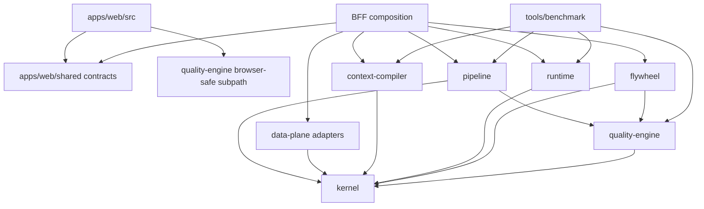
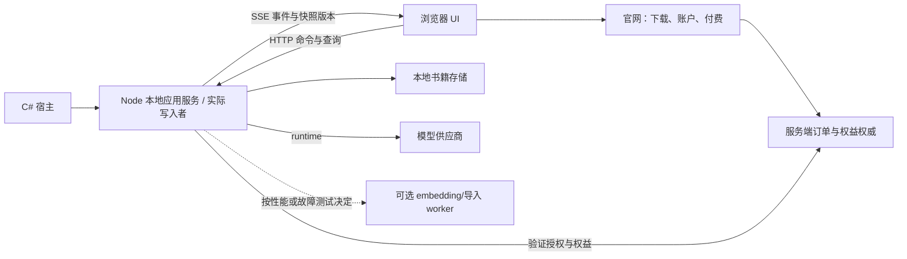
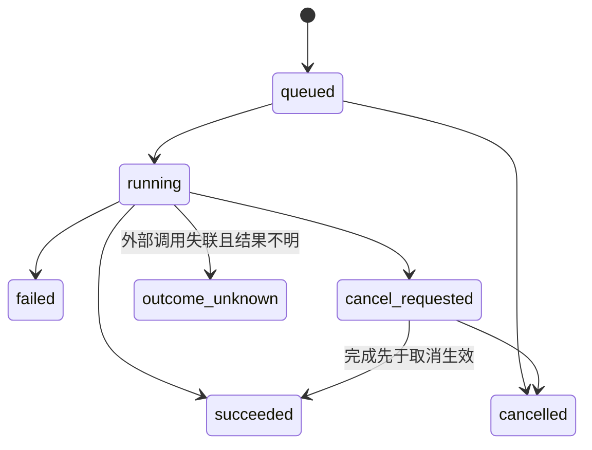

# 墨舟架构规划与分阶段执行方案

版本：1.0 · 2026-10-03（Asia/Shanghai） · 状态：规划已交付，实施未开始。

适用仓库：`C:\zcode\novel-ai`。基线分支 `feature/windows-local-release`，HEAD `90b45a1a1bf15a97b1cc690ad0b9872018aeebcb`，包含既有暂存、未暂存和未跟踪内容。完整证据快照见 §11；不能只比较 HEAD 判断文件未变。

本文是后续实施的统一规划依据，替代此前“四个核心包”汇报及四份 NEXT-ROUND 文档中与本文冲突的**建议**；不修改历史证据，不代替仓库现有 ADR。实施每项决策时更新对应 ADR，按现有编号分配规则新增或明确 supersede，不能默默绕开既有决策。

本次只交付文档、契约示例和执行清单，不修改产品代码，不提交、不推送、不发布。文中的 TypeScript、状态图和执行图是拟议契约，不是已经安装的框架或运行中的调度器。

文档工具记录：GitNexus 规划技能的 snapshot 已成功生成。其可选专用 write-plan 在 Windows/WSL 的 NTFS 上因 `renameat2 RENAME_NOREPLACE: EINVAL` 失败，未宣称安全写入器成功。按用户全局规则“非必需能力缺失时使用合适的普通工具链”，本次采用 Windows 原生独占创建新文件、Flush(true) 与全文 SHA-256 回读核对；未改技能和产品代码。执行者读取此文档时也不得因为可选文档工具不可用而重启整轮审计。

证据标签：`[verified]` 为本次源码/配置复核；`[graph]` 为此前本会话图谱结果；`[inferred]` 为工程推导；`[assumed]` 为实施时须定点验证的假设；`[决策]` 为本方案拟采用的设计；`[上游]` 为一手文档声明，不等于墨舟实测。

## 1. 目标与第一性原理

目标是让作者能够可靠地编辑、生成、采纳、提交、恢复和导出长篇书稿，并使后续模块变化局限在清楚的边界内。包数量、代码行数、框架新旧、测试总数都不是目标。

从需要保护的事实推导结构：

| 根本需求 | 必须成立的性质 | 由此得到的设计 |
|---|---|---|
| 作者的文字不能被旧任务覆盖 | 写入前重新验证版本与外部修改；结果可核对 | 单书事务边界、CAS、操作标识、恢复日志 |
| AI 结果可能失败、迟到或不被接受 | 生成与正典提交是不同操作 | 持久化候选、明确采纳、代次标识 |
| 模型供应商与上下文算法分别变化 | 改供应商不应重写写作状态机 | runtime、compiler、pipeline 分离 |
| 用户会关闭窗口、断网和重启 | UI 连接不是任务真实性依据 | 后端持有任务状态；快照与事件订阅 |
| 数据分属不同责任方 | 不同数据不能共用一个“全仓唯一写入包” | 每类资源一个权威所有者；应用负责装配 |
| 本地软件需要可安装、可升级和可撤回 | 架构必须覆盖发布生命周期 | 宿主、安装器、迁移、备份作为交付边界 |

范围：Windows 本地优先写作主线；已有本地/托管入口兼容；官网账户和商业权益边界。未授权新增云协作、重写桌面框架、建立微服务集群、把全产品迁到另一种数据库或引入 Agent 编排平台。

## 2. 已知现状与证据边界

下表只保留影响决策的证据，不重复全量审计。

| 事实 | 证据 | 规划影响 |
|---|---|---|
| `[verified]` 八个现有包的声明依赖包含 compiler/runtime 对 data-plane，flywheel 对 benchmark/pipeline 等 | `packages/*/package.json`，§11 所列快照 | 先按功能隔离，逐步将具体持久化依赖变为消费方端口，不一次改所有 import |
| `[verified]` 前滚只补写 partial，随后刷新基线并删除 journal | `packages/data-plane/src/chapter.ts:373` | 优先修复 untouched 及混合状态的恢复收敛 |
| `[verified]` 临时名固定，写入使用同步 open/write/fsync/rename | `packages/data-plane/src/atomic-write.ts:20` | 独立临时文件、写全、异常清理；不声称单线程同步调用已经实测交错 |
| `[verified]` 启动锁使用 PID 检查与 open('w')；单书队列位于 BFF | `apps/web/server/bookAccess.ts:41`、`:98` | 统一真正写入者的互斥协议；事务队列下沉为所有书稿写入口共同使用的边界 |
| `[verified]` prose 保存/提交入口存在，提交路由调用 runChapterCommit | `apps/web/server/routes/proseRoutes.ts:293`、`:519` | 路由保持薄适配；按实际 await 边界接入短事务，禁止把整个模型调用锁住 |
| `[verified]` flywheel 使用 benchmark 的运行时导出，不只是类型 | `packages/flywheel/src/evaluator/project.ts:23`；`packages/benchmark/src/index.ts` | 生产度量与评测运行器分离，迁移前保持导出兼容 |
| `[verified]` 追踪流为 JSONL，事件路径为 .mozhou/events.jsonl | `packages/data-plane/src/layout.ts:11`、`:24` | “仅 Markdown 能重建全部数据”的笼统说法不采用 |
| `[verified]` 仓库已有恢复/领域/上下文/运行时等 ADR | `docs/adr/INDEX.md` | 更新现有决策体系，不另立互相矛盾的架构权威 |

此前探针是构造盘面状态，不是物理断电；SQLite 副本仍有数据，不能写“所有副本永久丢失”。真实支付、长篇真实模型质量、物理断电和全部 Windows 发布路径仍不是已通过项。本文不把报告中的错误定级继续传递给实施者。

## 3. 大厂一手材料与目标架构

### 3.1 研究方法与可迁移结论

核查日期为 2026-10-03。使用内置网络检索和 Exa Search 两路检索，Exa 本轮返回 4 条结果，随后回到官方文档/源码核查。“当前在线文档”与“已正式发布能力”分开表述；不以爬取日期冒充发布日期。腾讯公开组件只能说明该组件设计，不能据此还原微信完整闭源架构。

| 一手材料 | 上游事实 | 墨舟采用的原则 | 不照搬的内容 |
|---|---|---|---|
| [Chromium Components Cookbook](https://www.chromium.org/developers/design-documents/cookbook/) | 组件拆分强调依赖方向、可复用核心和平台适配 | 规则核心与宿主实现分开，避免全局对象隐藏依赖 | Chromium 的目录数量和组织规模 |
| [Chromium Mojo & Services](https://chromium.googlesource.com/chromium/src/+/refs/heads/main/docs/mojo_and_services.md) | 类型化消息定义接口，服务实现可以在同进程或独立进程运行 | 先稳定契约，再因故障/权限/性能需要调整进程 | 不引入 Mojo/C++ IPC 作为墨舟通信框架 |
| [Chromium Service Guidelines](https://chromium.googlesource.com/chromium/src/+/refs/heads/main/services/README.md) | public 接口不能依赖 private 实现，接口需要文档 | exports、静态依赖规则、契约测试共同守边界 | 不把所有目录都升成独立服务 |
| [腾讯 Mars STN 源码](https://github.com/Tencent/mars/blob/master/mars/stn/stn.h) | 网络任务与业务回调通过明确接口连接 | runtime 适配供应商；业务工作流不混入网络驱动 | 不声称这些就是微信全部模块 |
| [VS Code Extension Host](https://code.visualstudio.com/api/advanced-topics/extension-host) | 扩展宿主按运行位置/能力区分，使用进程或 Web Worker 等运行形式 | 按资源与故障影响选择隔离，不按文件夹机械拆进程 | 不新增插件市场或扩展平台 |
| [VS Code Agent Host 文档](https://github.com/microsoft/vscode-docs/blob/main/docs/agents/concepts/agent-host.md) | 文档 DateApproved 为 2026-09-30；任务会话由 Host 持有，客户端获取快照与有序动作；AHP 仍在积极开发 | 长任务独立于窗口；重连读取真实状态；供应商接入统一会话模型 | 不迁入 AHP，不以新协议替换现有 HTTP/SSE |
| [Google AIP-155](https://google.aip.dev/155)、[154](https://google.aip.dev/154)、[151](https://google.aip.dev/151)、[180](https://google.aip.dev/180)、[194](https://google.aip.dev/194) | 请求标识、资源版本、长操作、兼容和重试分别有独立契约；自动重试指南不覆盖流式 RPC | 操作身份与版本冲突分开；长任务可查询；流式重试单独设计 | 不把 409 叫幂等，也不自动重试已经产生部分输出的生成 |

以上是原始材料支持的原则。下面的具体模块数量、任务顺序和实现取舍是针对墨舟的工程决策，不冒称为大厂官方建议。

### 3.2 统一模块裁决

**[决策] 目标保留七个生产能力包；benchmark 退出生产依赖图，成为开发评测工具。应用层与发布工具不混入包数量。** 当前八个 workspace 包不会在 P0 被立即调整；到 W6 才完成迁移。旧 benchmark 包可暂留转发兼容层，但迁移终点不能仍被生产代码依赖。

| 模块 | 负责与持有 | 明确不负责 | 对外契约/落地方式 |
|---|---|---|---|
| `kernel` | 叙事实体、领域值对象、版本语义、纯规则与不变量 | HTTP、SQLite、供应商协议、商业定价、全产品共享杂项 | 保留现名与领域行为，不降成只有类型的仓库；时间/ID 等非确定输入通过边界注入 |
| `data-plane` | 书籍文件、追踪流、书内候选/回执/任务/操作记录的持久化、投影、恢复、备份、迁移 | 模型选择、Prompt、业务状态转移政策、订单裁决、全仓日志写入 | 正典事务、只读快照、指定文档仓库端口；保留现名，不为命名一致性重命名 canon-store |
| `context-compiler` | 检索编排、筛选与预算、上下文包和回执构造；包内分纯编译 core 与检索 adapters | 写正文、调用生成模型、暗中保存回执、控制写作会话 | 输入快照/候选与预算，输出 packet/receipt；检索端口显式注入；embedding 与浏览器安全 core 分入口 |
| `runtime` | 模型驱动、请求协议、流式标准化、供应商错误、尝试编号与用量事件 | 小说十步工作流、书稿落盘、订单权威、未经政策允许的重试 | generate/abort/attempt 生命周期；持久化与审计由注入 sink 接收，不直连 data-plane |
| `pipeline` | 作者任务状态机、生成/审查/采纳/提交编排、取消与恢复策略 | 直接文件/SQL、HTTP/SSE 编码、供应商 SDK、前端状态 | 应用用例与任务状态；通过自有消费方端口调用 compiler/runtime/store |
| `quality-engine` | 纯文本质量计算、连续性/预算等可复用度量与规则评估 | 评测数据集执行、模型调度、评测报告落盘、合规法律保证 | 分文本指标与叙事指标子入口；必要领域类型可依赖 kernel，禁止反向引用 pipeline |
| `flywheel` | 作者反馈建模、画像/策略建议、生产使用的反馈度量 | 主写作事务成败、评测运行器、主动改正文、强制运行依赖 | 消费版本化反馈快照，输出建议；失败可重放/降级，现有画像可继续用 |
| `apps/web` 内部边界 | UI；HTTP contracts/client；BFF routes；composition；account/billing；凭据与平台适配 | 应用共享契约不能 import server 私有实现；UI 不能接触存储/密钥 | 优先保留一个 app，分别约束 src/shared/server；不为两份 DTO 新建全局 contracts 包 |
| `tools/benchmark`（拟新增） | 场景、夹具、评测运行器、长篇测试、报告与模型实验 | 生产所需的通用指标定义 | 从现有 benchmark 迁入；生产用数学度量迁往 quality-engine，配方事件解析迁往 runtime 的公共协议入口 |
| 宿主/发布工具 | 进程启动退出、日志定位、安装升级、签名验证 | 领域规则、书稿事务、模型编排 | 继续现有 C# 宿主和启动链；Tauri 空壳在引用清单迁移完成后归档，不换框架 |

度量迁移的分类：`evaluateMetricGate`/指标 ID/纯指标进入 quality-engine 的相应子入口；`readRecipeVersionFromPayload` 及配方快照协议归 runtime；评测矩阵行若仅服务实验则留 tools，生产消费者改收窄 DTO。不得因为“都被 benchmark 导出”就整包搬到 quality-engine，造成新的杂项模块。

### 3.3 代码依赖目标（箭头表示允许 import，不表示运行调用）



pipeline 声明它所需的端口，BFF 装配适配器；适配器可以实现端口但 data-plane 包本体不得为此反向 import pipeline。通过 TypeScript 结构类型在应用适配层满足接口。目标不要求每个函数套一层接口；只在 I/O、供应商和生命周期边界设端口。现有 concrete imports 分阶段替换，不能一次性删除旧入口。

### 3.4 运行与部署边界



首期仍保留单个 Node 本地服务；UI 关闭不等于提交撤销。生成是否后台继续由显式任务政策决定，默认用户点击“停止”发取消命令，不能仅关闭 SSE。服务退出不等于模型供应商已停止计费。

ONNX 原生线程池不构成“主线程永不阻塞”或“进程永不崩溃”的证明。W7 测量冷启动、分词、索引与 embedding 时的事件循环延迟及保存延迟；达到 §8 阈值或原生崩溃影响持久化进程时，迁入 worker/独立进程。需要崩溃隔离时选进程；仅 CPU JS 计算可先 worker thread。不要先改成分布式服务。

## 4. 图谱结果与影响范围

复用本会话既有图谱证据：`analyze --skip-agents-md --index-only --skip-skills --workers 2` 成功；`check --cycles -r .` 返回 `No circular imports found.`；`context recoverForward` 与 `impact atomicWriteFileSync` 未找到符号；`query recoverPendingCommit` 未返回有效目标链。此后未将旧结果冒充本次完整图谱通过。

**本次未过图谱门禁。** 这限制的是代码修改前的调用方覆盖，不阻止交付本规划。W0 只补首个任务相关符号的定位与 d=1/d=2 影响，不重新写全量审计。符号名失败时核对 repo 标识、文件路径、索引 schema/版本与真实符号 ID；最多两轮有新证据的修复，仍失败则标记该代码任务 BLOCKED，继续独立可做任务，不无限重复命令。

源码推导的重点影响面，不冒称完整图谱结果：恢复影响书籍打开/提交/投影重建；原子写影响备份临时文件过滤和异常清扫；写入权影响宿主/CLI/第二窗口；重试影响前端保存状态和章节缓存；度量迁移影响 flywheel 与 benchmark 公开导出。

## 5. 关键状态与顺序约束（PDG 缺口明确保留）

本次没有获得有效 PDG 切片，下列为源码核对后的设计约束，不是图谱生成结论。

1. 写入权取得 → 书籍恢复完成 → 校验请求身份/版本 → 书稿变更 → 结果记录可查询 → 返回成功。读取 UI 状态不能替代该链路。
2. 恢复冲突必须在破坏性动作之前尽量检出；仍可能在 I/O 中途失败，因此 journal 必须保留并可重入。
3. 完整写入、缓存读回正确、持久化完成、业务提交确认分别是不同事实。
4. 模型等待不占书稿事务锁；模型返回后重新检查书籍/章节/版本/任务代次，再保存候选或提交提案。
5. 取消请求只改变后续许可；已经成功的提交不因迟到取消变为失败。中止流连接也不能证明远端已中止。

## 6. 拟议设计与接口契约

### 6.1 每类资源一个权威所有者

| 资源 | 权威与写入责任 | 可否丢弃重建 |
|---|---|---|
| 正文、book 元数据、追踪 JSONL | data-plane 书籍事务 | 不可；需要版本与备份 |
| 已执行操作的结果记录 | data-plane 持久化；业务语义由调用用例定义 | 在承诺的去重窗口内不可丢；不能只存 LRU |
| 候选、回执、任务检查点 | pipeline/compiler 定义内容，data-plane 仓库负责书内落盘 | 按保留政策处理；未采纳候选不能因“非正典”随意删除 |
| 事件与用量记录 | 分别定义审计/任务/计费用途，服务通过指定 sink 写入 | 只有证明有完整上游来源的派生字段才可重建；usage 不自动视为缓存 |
| runtime.sqlite 的投影表 | data-plane 投影器 | 逐表证明可由明确输入重建，不给所有 SQLite 文件统一结论 |
| 订单、支付回调、退款与权益 | 商业服务的数据库和事务 | 不可用书稿 Markdown 重建；本地仅保存验证后的权益缓存 |
| 凭据、应用日志、安装状态 | 对应凭据/日志/宿主适配器 | 不属于 canon-store 权限；禁止把所有磁盘写入集中进书稿模块 |

### 6.2 恢复与原子写入

**W1 先做兼容性修复，保留当前日志格式与书籍布局。** 不在数据安全修复中顺手重命名包或换存储。

- 对每个追加目标：done 校验后跳过；untouched 追加完整载荷；partial 经前缀校验后截回基线再重放，或写入缺失后缀。W1 默认保留既有截断重放算法以控制改动，确保“截断后再次终止”可恢复，不能在别处声称已废弃截断。
- 不匹配前缀、缺文件、日志损坏、路径越界、正文两个锚均不匹配：保留日志与原件，拒绝该书写入并返回可定位错误；不猜测应覆盖哪个版本。
- 在删除 journal 前确认：目标完整、所需 flush 成功、投影内容匹配或完成明确的投影重建、manifest 与操作结果一致。`INSERT OR IGNORE` 后须比对已有内容，不能将被忽略的冲突当作成功。
- 文件层落实写全循环、唯一且独占创建的同目录临时文件、文件同步、替换、失败清理。清理只操作本次拥有的临时文件；同步更新备份过滤与恢复清扫规则。
- 明确 Windows 本地文件系统能力与目录元数据持久化策略；在没有平台验证前，只声明通过的进程崩溃保障。`readFile` 读回不能代替 fsync，单文件原子替换不能证明多文件事务掉电安全。
- backup/rebuild 遇到待恢复日志必须先判定事务；不能把不完整正典覆盖成新的干净投影。SQLite 损坏时保留原库副本与 WAL，按允许的数据库入口进行隔离测试，不删除真实书稿库试验。

参考：[SQLite 原子提交说明](https://www.sqlite.org/atomiccommit.html)解释了日志、同步顺序与硬件假设；其文档中的 rollback journal 实现不能直接当作墨舟 WAL/多文件事务的证明。[Node fs 文档](https://nodejs.org/api/fs.html)区分写入与同步操作。

### 6.3 写入权、队列与进程锁

**首选目标：实际写入者 Node 持有与规范化 dataRoot 绑定的 OS 锁句柄，生命周期覆盖全部书稿写入。** Windows 采用小型 `LockFileEx` 平台适配，通过本进程可调用的绑定持有；先在 W2 做限时验证，再集成打包。不是由独立 watchdog 代持，避免代持者退出而写入者仍存活。锁文件保持稳定身份，不在解锁后随意删除并重建同名文件。

`[assumed]` 仓库现有构建链能承载该原生适配，W2 验证 Win32/Node ABI 与发行架构。如果必须新增依赖，先检查许可证、构建可重复性、真实锁语义与维护状态，不为方便引入大框架。无法完成时保持安全拒绝第二写入者，报告 Windows 发布任务受阻；不以心跳接管作为替代。

迁移过渡：`wx` 可用于阻止首次并发创建；锁状态不明或存活进程未能可靠识别时保守拒绝写入。未经竞态证明，不执行“检测失效→删锁→抢锁”的自动回收。明确的锁诊断与用户操作恢复优于制造双写。旧 PID 文件格式只作迁移线索，不当作 OS 锁凭据。

- 心跳用于健康诊断，不授予写权限；30 秒超时不接管仍存活进程。
- C# Mutex 可继续负责单实例 UX，但不能成为 Node 绕过锁的环境变量开关。CLI、宿主、测试服务均走同一实际写入者入口。
- 支持目录别名、大小写、junction/符号链接指向同书的情况；锁键按受控解析后的真实书籍身份生成。多 Windows 会话和网络共享目录支持范围写入发布说明，未验证网络共享先拒绝为可写书根。
- 每书事务锁由存储写入会话强制要求，所有保存、采纳、提交、恢复、迁移、备份一致性快照入口共用。BFF 的旧队列可暂为门面；删除重复嵌套加锁，避免不可重入死锁。
- 显式队列条目维护顺序、取消排队、超时和最终释放；不能仅凭 Map<Promise> 命名就声称 FIFO。不同书独立并发，同书短事务串行，读者通过快照/已发布版本避免观察半次多文件提交。

上游锁 API 和限制参见 [Microsoft LockFileEx](https://learn.microsoft.com/en-us/windows/win32/api/fileapi/nf-fileapi-lockfileex)。锁只协调遵守协议的参与者，不阻止作者用外部编辑器修改文件，因此仍须写前摘要检查。

### 6.4 操作标识、版本、超时与重试

以下名称为拟议契约，不宣称仓库已有同名符号；在既有路由上增量兼容，不强制大规模改 URL。

```ts
type OperationKey = {
  bookId: string;
  operationId: string; // 客户端生成，同一次意图的重试必须复用
};
type SaveDraftCommand = OperationKey & {
  schemaVersion: 1;
  chapterId: string;
  expectedRevision: number;
  expectedSourceHash: string;
  body: string;
  title?: string;
};
type OperationStatus =
  | { state: "not_found"; safeToRetrySameId: boolean }
  | { state: "running"; operationId: string }
  | { state: "succeeded"; operationId: string; result: {
      appliedRevision: number; appliedBodyHash: string; commitId?: string
    }; currentRevision: number; replayed: boolean }
  | { state: "failed"; operationId: string; code: string }
  | { state: "cancelled"; operationId: string }
  | { state: "outcome_unknown"; operationId: string; retryAllowed: false };
```

规范：

1. 作用域至少包含当前授权主体、book、操作类型与 operationId；外部客户端不能自填可信 principal。服务端计算规范化请求摘要，覆盖正文、标题、预期版本和其他影响副作用的字段。
2. 在鉴权与输入校验后，先查相同操作记录：同 ID 同摘要返回原操作结果；同 ID 不同摘要返回 `OPERATION_ID_REUSED`。不得因为当前章节已定稿而否认先前已经成功的同一保存操作。
3. 查不到记录才做 CAS 与写前哈希检查。正文相同可作为“目标状态相同”的独立结果，但不得返回“证明此操作已执行”。LRU 只加速，不是证据源。
4. W3 将操作结果纳入同一恢复事务：草稿保存也需要可恢复的意图/结果记录；新 journal 版本保留旧格式恢复能力。操作记录不能独立先写“成功”、正文却未提交，也不能正文提交后遗失请求身份。
5. 初版不做自动操作记录清理，避免过早引入压缩协议；监测增长。后续保留策略必须先定义有效窗口与过期请求拒绝规则。重启后仍能查到旧结果；找不到且无法证明未执行时返回 outcome_unknown，不换新 ID 自动重试。
6. 成功后章节又被修改，重试返回历史 appliedRevision 与当前 currentRevision 两项；UI 不把当前版本误认成自己的正文基线，不覆盖未保存编辑。
7. 提交状态查询按 operationId，不只按章节或正文哈希；同一章节可能经历多次不同操作。状态 API 同样鉴权；查询结果不是新提交授权。
8. 模型请求超时且供应商结果不明，不自动开启新计费尝试。以稳定任务 ID、attempt ID 区分逻辑任务和外部调用。已有部分流输出时默认先对账/展示部分候选；不承诺跨供应商“严格只计费一次”。

错误码分组：版本/外部修改冲突；请求身份复用；写入权不可用；恢复冲突/损坏；临时 I/O 故障；供应商限流；结果不明；权限/输入错误。错误响应包含 operationId、可操作建议和有限重试信息，不回显密钥、完整本地路径或未授权书稿。

### 6.5 生成、取消、采纳与恢复



候选状态和任务状态分开：任务 cancelled 可以留下 contentState=partial 的候选，这是合理组合，不应强行改成同一个枚举。只有显式采纳才进入正典写入；半稿采纳需 `confirmPartial` 和最新 revision，不能由取消顺便写入正文。

HTTP 命令改变状态，SSE 只订阅进度。事件包含 schemaVersion、taskId、attemptId、generationEpoch、sequence；断线后根据游标补事件或返回快照。客户端切书/切章/停止后，旧代次 chunk 不更新当前编辑器。后端持久化终态，迟到 chunk 不能把 cancelled 改回 running；外部完成先于取消生效时如实返回 succeeded。

检查点仅保存重启所需状态与已获得的候选，不把未收到的供应商输出假装可恢复。“续写”是基于保留候选的新显式操作，有新 operationId 和可见成本，不是伪装成原流自动恢复。

### 6.6 接口、依赖与兼容迁移

- UI 只 import 应用共享 DTO/schema、客户端调用封装、明确 browser-safe 的纯计算入口；禁止 server、node 内建模块及存储依赖进入 UI 包图。
- 每个 public export 写明输入、输出、错误、副作用、版本、取消和重试语义；运行时验证不能只靠 TS 类型。
- 路由接收旧字段时由适配层转换；不提供 operationId 的旧客户端保留旧 CAS 语义，不能承诺跨重启去重；响应新增字段保持兼容，删除字段需要版本迁移。
- exports 只约束包入口，不能单独阻止相对路径跨层 import；同时使用 ESLint/import 约束、浏览器构建检查和契约测试。
- compiler 返回 receipt，由调用层决定保存；runtime 发出事件，由配置的 sink 保存；flywheel 消费领域反馈 DTO，不读取 pipeline 的内部日志实现。状态归属与物理存储分别明确。
- `billingCatalog` 的公开投影通过应用共享 schema + HTTP 返回；商业价格和权益以服务端裁决为准。纯常量复用本身不是泄密，但不能让 UI 依赖 server 私有实现。不要把商业目录搬入 kernel。

### 6.7 商业与发布边界

官网负责下载、账户和付费，桌面负责写作。服务端确认订单/退款/权益；本地缓存必须带版本与有效期政策，付费失败不能锁死阅读、手动编辑、备份和导出已有作品。

现有商业模块先保留目录服务边界，按部署角色装配；本地发行构建不得携带支付服务密钥或开启可伪造本地订单的生产支付入口。网站与桌面必须在启动配置/路由许可/密钥能力上明确区分，未来有真实部署需要再拆 app，不因图好看立即复制整套 web。

上线分两条门槛：本地非付费预览完成 W1–W7 适用验收；公开付费版还须 W8 真实渠道履约、退款、重复回调、成本与权益验收。代码签名是发行身份保障，不保证所有环境没有信誉警告。签名证书、真实调用与付款测试的新增费用仍须具体授权。

## 7. 执行顺序与任务卡

每张卡对应可观察结果，不靠包搬迁数量验收。序号是依赖顺序，不是工期承诺；实施后用实际耗时更新估算。代码与数据格式迁移分开交付。每卡落地均执行适用图谱门禁和调用方回归。


### W0 — 固定起点，直接进入实施准备

- 输入：本文、当前源码与未提交内容。输出：实施记录、首张卡相关链路和 d=1/d=2 影响清单。
- 只核对漂移文件、相关 ADR 和受影响调用方；不再开展全仓审计，不再要求用户传递报告。
- 运行上下文核对仓库/分支/工作区；保留已有暂存区。记录门禁缺口，不拿本规划当完整图谱通过证明。
- 成功：首卡可定位、影响清楚、测试入口已确认。失败：最多两轮定点诊断；BLOCKED 仅作用于依赖该缺口的代码任务。

### W1 — 恢复后的书稿与追踪数据一致

- 现有修改入口：`packages/data-plane/src/chapter.ts`、`atomic-write.ts`；涉及路径常量遵循 `layout.ts`。
- 新增测试建议路径：`packages/data-plane/src/recovery-reentry.test.ts`（拟新增，复用现有测试设施，重复文件则并入现有套件）。
- 实施：untouched/partial/done 混合恢复、投影冲突检出、可靠写全与清理、保留 journal、错误读写模式。
- 验收：每个写阶段异常/子进程终止后，多次重新打开结果相同；既无重复增量，也无静默缺项；事件路径正确；错误不删唯一恢复证据。
- 回退：代码可回退本卡；不得为回退删除 journal 或覆盖较新的书稿。数据格式未改，保留原件。

### W2 — 多入口访问同书只有一个有效写入者

- 现有入口：`apps/web/server/bookAccess.ts`、`routes/proseRoutes.ts`；宿主/CLI 路径在定点链路中确认。
- 新增适配建议：`apps/web/server/platform/writerLock.ts`（拟新增）；内部 OS 绑定按 §6.3 限时验证，最多两种实现路径，不循环换库。
- 实施：实际写入者锁、受控锁迁移、规范化书籍身份、存储事务会话、短临界区、无重复嵌套锁；临时名变动同步备份过滤。
- 验收：宿主+CLI 同开、两个 CLI、两个目录别名；暂停旧进程超过 30 秒后仍无双写；宿主退出但 Node 存活时第二写入者仍不得进入；进程真正退出后可重新取得写入权并恢复。
- 回退：保守拒绝写入优先于允许双写。OS 适配/发行验证不通过时阻断发布，不回退成超时抢锁。

### W3 — 保存和提交超时后能确认自己的结果

- 现有入口：proseRoutes、data-plane 的保存/提交实现；前端保存调用方按图谱确定。
- 拟新增：应用共享操作 DTO、书内 operation result 仓库、journal 版本迁移、操作状态查询；路径按现有布局集中定义，不在多个模块硬编码。
- 实施：服务端摘要、同 ID 绑定同意图、先去重后 CAS、成功结果与变更同恢复单元、历史结果和当前版本分离。
- 验收：响应丢失、重启、同 ID 不同内容、他人同内容、成功后被新编辑、缓存淘汰、半次结果写入；均符合 §6.4。
- 回退：新日志可恢复后才开启新写格式；旧程序不认识新格式必须拒绝写入。恢复到升级前备份只在无新用户写入或已完整保全增量时执行，绝不覆盖更新的作品。

### W4 — 停止、切章、断线与重启都有一致结果

- 输入：W3 的操作状态与持久化能力。入口：pipeline 工作流、runtime 流驱动、相关 BFF/SSE、编辑器消费方；现有符号由实施者定点确认。
- 实施：task/attempt/epoch/sequence；cancel_requested 与最终结果；快照重连；候选 contentState；显式半稿采纳；结果不明禁止自动新计费尝试。
- 验收：停止后晚到流不改正文；切章/关窗口不串书；取消后残留部分候选可查看，未确认不采纳；重启后显示真实状态而非永远 running。
- 回退：保留任务与候选格式读取，关闭新生成入口而不删除候选。不能用丢弃未保存用户文字换取 UI 一致。

### W5 — 先建立边界防护，保持行为不变

- 入口：apps/web 的 shared/server/src 分界，package exports，ESLint 和浏览器构建配置。
- 实施：公共 DTO/运行时 schema、客户端适配、billing 公开投影、禁止 UI→server；按包增加可兼容出口。
- 验收：正常前端生产构建、入口调用可用；故意引入跨层 import 的负向测试失败；已用包路径不因 exports 变化突然失效。
- 可与 W1–W4 独立工作串行交付；涉及同一路由文件则等该卡完成，不默认多代理并行改文件。

### W6 — 完成七个生产包与开发评测工具的迁移

- 顺序：先迁生产纯指标与配方协议 → 保留旧 benchmark 转发 → 更新 flywheel 等调用方 → 迁走 runner/fixtures → 移除生产依赖 → 再移除兼容层。
- compiler/core 与 adapters 分入口，移出回执写入；runtime 移出具体书籍写入；pipeline 接消费方端口；BFF 实现装配；flywheel 接反馈快照。
- 每次迁移一个已列调用链，先建新出口并跑等价性测试，再切调用方，最后删旧实现。禁止复制两份长期维护。
- 验收：七包生产图无 benchmark 依赖；无反向层依赖；相同语料和固定输入的指标、上下文预算及回执语义保持预期；原导出兼容期测试通过。
- 回退：调用方回切兼容适配，保留单份实现；不要在同卡迁移持久化格式。

### W7 — 性能、安装升级和本地发行候选验收

- 输入：W1–W6 合并后的同一工作区版本、隔离书籍夹具、发行构建。
- 实施：事件循环/保存/内存观测；必要的计算隔离；安装/升级/卸载数据保留；签名能力配置；Tauri 引用清单与宿主文档一致；发布配置检查。
- 验收：§8 的用户旅程、性能与兼容矩阵；关闭 UI/宿主/服务的不同语义；标准用户权限；旧书打开；新格式降级拒写；备份导出可读。
- 回退：保留旧安装包与版本化迁移备份，不将旧可执行程序对新格式的盲写视为回退方案。
- 输出：发行候选验收报告，不能在没有对应授权时上传、推送、签发购买或发布。

### W8 — 公开付费版的条件分支

- 复用既有商业能力，不在本地编造履约权威。明确官网/服务端/桌面部署角色与允许路由。
- 已有配置与授权足够时做支付渠道沙箱、重复/乱序回调、退款、取消、到期、离线权益和成本上限验证；缺少商户/证书/费用授权时只阻塞相关验收，继续其他已授权项。
- 真正对外收费前，至少一条获准的真实支付与退款履约链路完成且证据可复查；模拟 checkout 不能算通过。提供用户数据与金额脱敏证据。
- 若只发布不收费预览，可将付费入口不可用并明确标识，W8 不作为本地编辑功能验收的前提；不能一边挂付费入口一边跳过履约验收。

## 8. 验证策略与验收矩阵

测试 ID 是待实施用例，不表示当前已经存在或通过。自动化测试使用隔离书籍，禁止写真实书稿。数据库检查遵循 dbhub MCP/规定 DbHub 入口；连接器不可用时记录具体阻塞，不绕过驱动直接查询真实库。

| ID | 场景 | 必须观察的结果 |
|---|---|---|
| REC-01 | 一个事务混合 untouched/partial/done，重复恢复三次 | 最终目标完整、无重复、journal 仅在满足终态后移除 |
| REC-02 | 在截断、追加、投影、manifest、结果记录前后逐点异常/子进程强杀 | 能恢复或明确拒绝写入；不会无声确认为完成 |
| REC-03 | 日志损坏、目标丢失、前缀冲突、磁盘满/拒写/同步失败 | 原件与恢复证据保留；UI 给出可定位错误 |
| REC-04 | 隔离副本的投影损坏/缺失与旧格式升级 | 按逐表重建契约恢复，操作记录/用户候选不被误删 |
| LOCK-01 | 宿主/CLI/别名/跨会话争抢同一真实书根 | 同时最多一个合法写入者；另一方有明确状态 |
| LOCK-02 | 持有者暂停 >30s、宿主单独退出、writer 真正终止 | 暂停不接管；独立 Node 仍有保护；退出后可安全恢复 |
| IDEM-01 | 保存成功响应丢失，重启后用同 ID 重试 | 返回该操作结果，正文/版本/事件不重复变更 |
| IDEM-02 | 同 ID 不同标题/正文/预期版本；他人保存相同正文 | 前者拒绝身份复用；后者不能冒称自身成功 |
| IDEM-03 | 操作成功后又被修改或定稿，再重试原请求 | 历史操作结果与当前版本明确分开，不覆盖新文字 |
| GEN-01 | 停止、切章、切书、关闭窗口后晚到流 | 不污染当前正文；候选归属与任务状态正确 |
| GEN-02 | 外部结果不明、部分输出、取消与成功竞态 | 不盲目重计费；已完成不伪造撤销；半稿采纳明确确认 |
| API-01 | 旧客户端/新增字段/未知 schemaVersion/越权 bookId | 兼容策略明确；不静默解释未知写入协议；权限不退化 |
| MOD-01 | 浏览器构建及生产依赖扫描 | 无 server 私有实现/密钥/Node存储进入 UI；无 benchmark runner 进入生产 |
| USER-01 | 编辑→保存→重启→生成→停止→采纳→提交→导出→恢复备份 | 编辑器、服务端读回、磁盘内容、版本、导出一致 |
| RELEASE-01 | 全新标准用户安装、旧版升级、无网启动、卸载重装 | 作品保留、旧书可打开、未授权覆盖被拒绝 |
| BILL-01 | 重复/乱序回调、退款、到期、离线缓存过期 | 服务端权益一致，基础写作/导出不被错误锁死 |

性能目标是本方案提出的首轮验收预算，不是已测数据：在记录型号/内存/磁盘/OS 的目标普通 Windows 机器上，50 章本地固定夹具，10KB 正文保存端到端 p95 ≤300ms；索引/embedding 同时运行时 p95 ≤600ms、事件循环延迟 p95 ≤50ms。首测记录冷/热启动分开结果；不达标先剖析，再按 §3.4 隔离计算，不直接放宽标准或伪称“原生线程池无影响”。50章固定夹具只验证规模与行为，不证明长篇文学质量。

本轮确认存在的仓库脚本（尚未执行，执行前复核其当前定义和真实模型开关）：`pnpm build`、`pnpm lint`、`pnpm test:packages`、`pnpm test:web`、`pnpm --filter @mozhou/web build`、`pnpm check:architecture`、`pnpm check:gates`、`pnpm check:glossary`。先运行受影响测试，阶段汇合时再跑相关全量门禁，避免每个纯移动步骤都重跑全部实验。

图谱：修改前 d=1/d=2；交付前 detect_changes 与 `pnpm graph:check`，要求当前索引的 status clean/cycleCount 0，字段或命令不可用则明确受阻。不为图谱数据漂亮而改写用户 AGENTS。任何 push 仍须相应授权和全局本地 CI 门禁，本方案不授予推送权限。

真实模型验收只在费用/数据范围已授权时执行；mock 与真实供应商结果分开。物理断电测试单列，不以抛异常、截断文件或 kill 进程冒充。没有对应证据时不对用户承诺“断电绝不丢字”。

## 9. 风险、兼容与回退

| 风险 | 控制措施 | 回退边界 |
|---|---|---|
| 既有脏工作区被覆盖 | 记录 HEAD 与文件摘要，逐卡小差异；保留暂存状态 | 不 reset --hard、不 clean、不擅自 stash |
| 写锁改造让应用无法启动 | 锁定点验证、保守错误、诊断入口、打包实测 | 安全拒写可接受，双写不可作为退路 |
| 新 operation/journal 格式旧版本误读 | 版本字段、旧格式读取、新格式写入开关、迁移备份 | 旧版本明确拒写未知格式；保护升级后新增内容 |
| API 返回成功掩盖他人更新 | applied/current 版本分离，完整请求摘要 | 恢复旧接口也必须保留服务端冲突检查 |
| 边界迁移破坏第三方或测试调用方 | 公开导出清单、兼容层、逐个调用链迁移 | 已核验消费方全部切换后再删旧出口 |
| 全书队列阻塞手写保存 | 模型等待出锁，短事务，排队取消/限时 | 可降级暂停生成，保留编辑和导出 |
| 数据库“缓存”误判 | 逐表写清权威来源、恢复路径、不可重建部分 | 不允许统一删除 .mozhou 或所有 sqlite |
| 原生绑定供应链与平台风险 | 小接口、固定版本、许可证与构建验证、发行架构实测 | W2 失败则阻断相关发布，不引入更多框架绕过 |

完整 d=1 调用方清单尚缺图谱支持，不声称上表覆盖全部。各卡实施前补充属于该卡的真实调用方，交付列明通过/失败/未测；数据库、宿主、HTTP、动态装配不能只靠静态图谱证明。

## 10. 执行编排与进度状态

使用简单、可审阅的执行图与任务状态文件，不安装新的编排平台。机器可读清单见随附 `墨舟执行任务图.json`；它描述依赖，不会自动运行命令。

- 状态：pending → running → passed；失败进入 repair；缺外部条件进入 blocked。最多两轮针对同一原因且有新证据的修复；无进展停止该路径并继续独立工作。
- 每节点输入：本文版本、前置产物、当前 HEAD/dirty 摘要、允许文件范围。输出：差异摘要、验证命令与退出码、真实结果、未覆盖对象、回退点。
- 执行结果分别记录 implementation_status、verification_status、release_status，不能以节点 finished 代替验收。
- 自动化检查失败不能用修改期望值/跳过测试/更新黄金基线来消除，除非该行为变化属于本卡明确契约。
- 任务清单默认串行，W5 是条件允许的独立分支，不构成多代理授权。若以后显式授权并行，先分配不相交写入范围与汇合版本。
- 中断后先读已有记录与实际产物，确认外部操作是否发生；只重跑未完成步骤。结果不明的支付/模型调用先对账，不能当成未执行。

## 11. Implementation Context — 执行上下文包

以下 JSON 由本轮记录与官方证据 helper 合成。snapshot 保留 schema-2 原字段，生成计划路径为唯一排除项。它是规划时快照，不要求执行期间每次改动仍匹配原摘要；启动时先比对漂移，后续每卡建立自己的版本记录。

```json
{
  "implementation_context": {
    "task_summary": "从现有审计直接实施墨舟可靠性与模块边界改造；保留七个生产能力包，分离开发评测；按 W0-W8 分阶段验证，不重做全量审计。",
    "acceptance_criteria": [
      "恢复前滚终态与 journal 清理一致",
      "同书实际写入权唯一",
      "操作结果跨重启可对账",
      "取消与迟到流不覆盖书稿",
      "生产依赖不含评测运行器",
      "真实桌面/升级验收与商业条件分开"
    ],
    "evidence_provenance": {
      "schema_version": 2,
      "head_commit": "90b45a1a1bf15a97b1cc690ad0b9872018aeebcb",
      "generated_plan_path": "docs/plans/2026-10-03-gitnexus-plan-mozhou-architecture-release.md",
      "global_dirty_digest": {
        "algorithm": "sha256",
        "canonicalization": "gitnexus-evidence-provenance-v2 NUL-framed UTF-8 records",
        "value": "ff5e22a0c3c89371ff92b354acd9179363e51eaea88553c3d807b463ae10783e"
      },
      "cited_path_manifest": [
        {
          "path": "AGENTS.md",
          "object_kind": {
            "head": "regular",
            "index": "regular",
            "worktree": "regular",
            "untracked": "absent"
          },
          "state": "unstaged",
          "rename_from": null,
          "rename_to": null,
          "head_digest": "sha256:6c8795eaefed85b9ee91ac2222d034c244bb7212419eae82cb560f8983fa9d80",
          "index_digest": "sha256:6c8795eaefed85b9ee91ac2222d034c244bb7212419eae82cb560f8983fa9d80",
          "worktree_digest": "sha256:6505f9ef71f07fff81ce5574748abceb7196ae8a8e16b8e5d61e7a5a9c6ef982",
          "untracked_digest": "absent"
        },
        {
          "path": "apps/web/server/bookAccess.ts",
          "object_kind": {
            "head": "regular",
            "index": "regular",
            "worktree": "regular",
            "untracked": "absent"
          },
          "state": "clean",
          "rename_from": null,
          "rename_to": null,
          "head_digest": "sha256:c47222b4d7938174e33f77a44a88252c7aa7c13d2bbafd5aee135ab70a362f5f",
          "index_digest": "sha256:c47222b4d7938174e33f77a44a88252c7aa7c13d2bbafd5aee135ab70a362f5f",
          "worktree_digest": "sha256:c47222b4d7938174e33f77a44a88252c7aa7c13d2bbafd5aee135ab70a362f5f",
          "untracked_digest": "absent"
        },
        {
          "path": "apps/web/server/routes/proseRoutes.ts",
          "object_kind": {
            "head": "regular",
            "index": "regular",
            "worktree": "regular",
            "untracked": "absent"
          },
          "state": "clean",
          "rename_from": null,
          "rename_to": null,
          "head_digest": "sha256:166d2f1a7d16d6de8ff0eaf7867f634d70313b89813e19773654b17eb397af3b",
          "index_digest": "sha256:166d2f1a7d16d6de8ff0eaf7867f634d70313b89813e19773654b17eb397af3b",
          "worktree_digest": "sha256:166d2f1a7d16d6de8ff0eaf7867f634d70313b89813e19773654b17eb397af3b",
          "untracked_digest": "absent"
        },
        {
          "path": "docs/adr/INDEX.md",
          "object_kind": {
            "head": "regular",
            "index": "regular",
            "worktree": "regular",
            "untracked": "absent"
          },
          "state": "clean",
          "rename_from": null,
          "rename_to": null,
          "head_digest": "sha256:97303334d749f9e0ec75e098a7e76fab08cd2304169f81303b723576162143cc",
          "index_digest": "sha256:97303334d749f9e0ec75e098a7e76fab08cd2304169f81303b723576162143cc",
          "worktree_digest": "sha256:26f2debf4f89285bfae5982bd622b0e59d62fda490888f5cce2197fa5d64282b",
          "untracked_digest": "absent"
        },
        {
          "path": "package.json",
          "object_kind": {
            "head": "regular",
            "index": "regular",
            "worktree": "regular",
            "untracked": "absent"
          },
          "state": "unstaged",
          "rename_from": null,
          "rename_to": null,
          "head_digest": "sha256:6c6ec2f30fd4ac46b2199a01ffa15be9ebe753c3daec4130c43de7127a630bd2",
          "index_digest": "sha256:6c6ec2f30fd4ac46b2199a01ffa15be9ebe753c3daec4130c43de7127a630bd2",
          "worktree_digest": "sha256:6307ba3054253ebc8d28fba4729ca362a0c7d0613056aaf654c2f1ff91b0672b",
          "untracked_digest": "absent"
        },
        {
          "path": "packages/benchmark/package.json",
          "object_kind": {
            "head": "regular",
            "index": "regular",
            "worktree": "regular",
            "untracked": "absent"
          },
          "state": "clean",
          "rename_from": null,
          "rename_to": null,
          "head_digest": "sha256:ff8c6a669fb4575bf08fbfc12c6e7cd56e81c3ab76e2e60c427da9a84ed10c92",
          "index_digest": "sha256:ff8c6a669fb4575bf08fbfc12c6e7cd56e81c3ab76e2e60c427da9a84ed10c92",
          "worktree_digest": "sha256:ff8c6a669fb4575bf08fbfc12c6e7cd56e81c3ab76e2e60c427da9a84ed10c92",
          "untracked_digest": "absent"
        },
        {
          "path": "packages/benchmark/src/index.ts",
          "object_kind": {
            "head": "regular",
            "index": "regular",
            "worktree": "regular",
            "untracked": "absent"
          },
          "state": "clean",
          "rename_from": null,
          "rename_to": null,
          "head_digest": "sha256:fda7aeaebf502734bbf644136f60512225f99304f4808e6483e6067b1b8dd8f4",
          "index_digest": "sha256:fda7aeaebf502734bbf644136f60512225f99304f4808e6483e6067b1b8dd8f4",
          "worktree_digest": "sha256:fda7aeaebf502734bbf644136f60512225f99304f4808e6483e6067b1b8dd8f4",
          "untracked_digest": "absent"
        },
        {
          "path": "packages/context-compiler/package.json",
          "object_kind": {
            "head": "regular",
            "index": "regular",
            "worktree": "regular",
            "untracked": "absent"
          },
          "state": "clean",
          "rename_from": null,
          "rename_to": null,
          "head_digest": "sha256:2aad05bfbff02df0f5b7e396f408c84ac5c25c68d0c0ab7f55ada6e460309f85",
          "index_digest": "sha256:2aad05bfbff02df0f5b7e396f408c84ac5c25c68d0c0ab7f55ada6e460309f85",
          "worktree_digest": "sha256:2aad05bfbff02df0f5b7e396f408c84ac5c25c68d0c0ab7f55ada6e460309f85",
          "untracked_digest": "absent"
        },
        {
          "path": "packages/data-plane/package.json",
          "object_kind": {
            "head": "regular",
            "index": "regular",
            "worktree": "regular",
            "untracked": "absent"
          },
          "state": "clean",
          "rename_from": null,
          "rename_to": null,
          "head_digest": "sha256:69e47124d70a0758e278840ceb012484fba61bf860548ad2592434f0b04c970c",
          "index_digest": "sha256:69e47124d70a0758e278840ceb012484fba61bf860548ad2592434f0b04c970c",
          "worktree_digest": "sha256:69e47124d70a0758e278840ceb012484fba61bf860548ad2592434f0b04c970c",
          "untracked_digest": "absent"
        },
        {
          "path": "packages/data-plane/src/atomic-write.ts",
          "object_kind": {
            "head": "regular",
            "index": "regular",
            "worktree": "regular",
            "untracked": "absent"
          },
          "state": "clean",
          "rename_from": null,
          "rename_to": null,
          "head_digest": "sha256:9c8e5080eba48549fcec4902c04cf544dadacc65b64a094dfde7150db7c60d3d",
          "index_digest": "sha256:9c8e5080eba48549fcec4902c04cf544dadacc65b64a094dfde7150db7c60d3d",
          "worktree_digest": "sha256:9c8e5080eba48549fcec4902c04cf544dadacc65b64a094dfde7150db7c60d3d",
          "untracked_digest": "absent"
        },
        {
          "path": "packages/data-plane/src/chapter.ts",
          "object_kind": {
            "head": "regular",
            "index": "regular",
            "worktree": "regular",
            "untracked": "absent"
          },
          "state": "clean",
          "rename_from": null,
          "rename_to": null,
          "head_digest": "sha256:e18022015af1f886c1130346406b4943594af6ecef34c97115c76c07d269c300",
          "index_digest": "sha256:e18022015af1f886c1130346406b4943594af6ecef34c97115c76c07d269c300",
          "worktree_digest": "sha256:e18022015af1f886c1130346406b4943594af6ecef34c97115c76c07d269c300",
          "untracked_digest": "absent"
        },
        {
          "path": "packages/data-plane/src/layout.ts",
          "object_kind": {
            "head": "regular",
            "index": "regular",
            "worktree": "regular",
            "untracked": "absent"
          },
          "state": "clean",
          "rename_from": null,
          "rename_to": null,
          "head_digest": "sha256:ed839fd3b3c913f4b47f944a6790e30273311552b856e63454151f8fbf191d12",
          "index_digest": "sha256:ed839fd3b3c913f4b47f944a6790e30273311552b856e63454151f8fbf191d12",
          "worktree_digest": "sha256:ed839fd3b3c913f4b47f944a6790e30273311552b856e63454151f8fbf191d12",
          "untracked_digest": "absent"
        },
        {
          "path": "packages/flywheel/package.json",
          "object_kind": {
            "head": "regular",
            "index": "regular",
            "worktree": "regular",
            "untracked": "absent"
          },
          "state": "clean",
          "rename_from": null,
          "rename_to": null,
          "head_digest": "sha256:1b0da60ec68262d8f4eb303ffd2d1f1b8179aa2b23a59da7e1f568b2763f75c0",
          "index_digest": "sha256:1b0da60ec68262d8f4eb303ffd2d1f1b8179aa2b23a59da7e1f568b2763f75c0",
          "worktree_digest": "sha256:1b0da60ec68262d8f4eb303ffd2d1f1b8179aa2b23a59da7e1f568b2763f75c0",
          "untracked_digest": "absent"
        },
        {
          "path": "packages/flywheel/src/evaluator/project.ts",
          "object_kind": {
            "head": "regular",
            "index": "regular",
            "worktree": "regular",
            "untracked": "absent"
          },
          "state": "clean",
          "rename_from": null,
          "rename_to": null,
          "head_digest": "sha256:45761596b7dc5b59f7a943572ab50bec5de0cdd3dadcbf992c6a1bc6db38c549",
          "index_digest": "sha256:45761596b7dc5b59f7a943572ab50bec5de0cdd3dadcbf992c6a1bc6db38c549",
          "worktree_digest": "sha256:45761596b7dc5b59f7a943572ab50bec5de0cdd3dadcbf992c6a1bc6db38c549",
          "untracked_digest": "absent"
        },
        {
          "path": "packages/kernel/package.json",
          "object_kind": {
            "head": "regular",
            "index": "regular",
            "worktree": "regular",
            "untracked": "absent"
          },
          "state": "clean",
          "rename_from": null,
          "rename_to": null,
          "head_digest": "sha256:06f0f7a63e7155379ad7d90b1e4581d063f0b769ebfdeaef95745ac31e6c2d4c",
          "index_digest": "sha256:06f0f7a63e7155379ad7d90b1e4581d063f0b769ebfdeaef95745ac31e6c2d4c",
          "worktree_digest": "sha256:06f0f7a63e7155379ad7d90b1e4581d063f0b769ebfdeaef95745ac31e6c2d4c",
          "untracked_digest": "absent"
        },
        {
          "path": "packages/pipeline/package.json",
          "object_kind": {
            "head": "regular",
            "index": "regular",
            "worktree": "regular",
            "untracked": "absent"
          },
          "state": "clean",
          "rename_from": null,
          "rename_to": null,
          "head_digest": "sha256:ad71f76ef0b90f77c56125cbb8237e56c4326452bfdf2c6fae41359679ba6138",
          "index_digest": "sha256:ad71f76ef0b90f77c56125cbb8237e56c4326452bfdf2c6fae41359679ba6138",
          "worktree_digest": "sha256:ad71f76ef0b90f77c56125cbb8237e56c4326452bfdf2c6fae41359679ba6138",
          "untracked_digest": "absent"
        },
        {
          "path": "packages/quality-engine/package.json",
          "object_kind": {
            "head": "regular",
            "index": "regular",
            "worktree": "regular",
            "untracked": "absent"
          },
          "state": "clean",
          "rename_from": null,
          "rename_to": null,
          "head_digest": "sha256:97fae218f7fff38dca0d164d2881958ecd61d4f9484579e504b2645410a135a9",
          "index_digest": "sha256:97fae218f7fff38dca0d164d2881958ecd61d4f9484579e504b2645410a135a9",
          "worktree_digest": "sha256:97fae218f7fff38dca0d164d2881958ecd61d4f9484579e504b2645410a135a9",
          "untracked_digest": "absent"
        },
        {
          "path": "packages/runtime/package.json",
          "object_kind": {
            "head": "regular",
            "index": "regular",
            "worktree": "regular",
            "untracked": "absent"
          },
          "state": "clean",
          "rename_from": null,
          "rename_to": null,
          "head_digest": "sha256:c06bd5da6d479f152d3a587f7fbd212bd3d1bfdf1c9104bae2bafbde7e5b071a",
          "index_digest": "sha256:c06bd5da6d479f152d3a587f7fbd212bd3d1bfdf1c9104bae2bafbde7e5b071a",
          "worktree_digest": "sha256:c06bd5da6d479f152d3a587f7fbd212bd3d1bfdf1c9104bae2bafbde7e5b071a",
          "untracked_digest": "absent"
        }
      ]
    },
    "primary_symbols": [
      {
        "symbol": "recoverForward",
        "file": "packages/data-plane/src/chapter.ts",
        "lines": "373-420",
        "role": "恢复补写、投影与 journal 清理；源码已核对，图谱定位缺失"
      },
      {
        "symbol": "atomicWriteFileSync",
        "file": "packages/data-plane/src/atomic-write.ts",
        "lines": "20-32",
        "role": "同步临时写/同步/替换；源码已核对"
      },
      {
        "symbol": "DataRootProcessLock",
        "file": "apps/web/server/bookAccess.ts",
        "lines": "41-92",
        "role": "现有 PID 文件锁；源码已核对"
      },
      {
        "symbol": "BookOperationQueue",
        "file": "apps/web/server/bookAccess.ts",
        "lines": "98-115",
        "role": "现有每书队列；源码已核对"
      }
    ],
    "related_symbols": [
      {
        "symbol": "runChapterCommit",
        "relationship": "call site at proseRoutes.ts:519",
        "relevance": "已确认路由调用点；实现与完整调用方在 W0/W2 定点定位，不宣称已取得完整影响图"
      }
    ],
    "execution_path": [
      "鉴权/输入验证",
      "确认实际写入权与恢复状态",
      "按 operationId 查询既有结果",
      "无结果时校验版本和源摘要",
      "短事务内变更与结果记录",
      "完成必要同步后返回",
      "UI 独立处理历史结果和当前版本"
    ],
    "pdg_constraints": [],
    "architectural_patterns": [
      {
        "pattern": "领域核心与 I/O 分离",
        "example_location": "packages/kernel/package.json",
        "usage_guidance": "保留领域行为，不塞入商业 DTO"
      },
      {
        "pattern": "版本化恢复日志",
        "example_location": "packages/data-plane/src/chapter.ts",
        "usage_guidance": "先兼容修復，再在 W3 引入操作身份，保留旧格式恢复能力"
      }
    ],
    "files_to_modify": [
      {
        "file": "packages/data-plane/src/chapter.ts",
        "symbols": [
          "recoverForward"
        ],
        "intended_change": "W1 前滚重入与冲突检验；W3 操作结果同恢复单元"
      },
      {
        "file": "packages/data-plane/src/atomic-write.ts",
        "symbols": [
          "atomicWriteFileSync"
        ],
        "intended_change": "写全、独占临时文件、同步、清理；调用方与备份规则一起验证"
      },
      {
        "file": "apps/web/server/bookAccess.ts",
        "symbols": [
          "DataRootProcessLock",
          "BookOperationQueue"
        ],
        "intended_change": "W2 实际写入权与短事务装配"
      },
      {
        "file": "apps/web/server/routes/proseRoutes.ts",
        "symbols": [],
        "intended_change": "W2/W3 适配事务与操作结果；保留既有路由兼容"
      },
      {
        "file": "packages/flywheel/src/evaluator/project.ts",
        "symbols": [],
        "intended_change": "W6 使用新的配方快照公共协议入口"
      },
      {
        "file": "packages/benchmark/src/index.ts",
        "symbols": [],
        "intended_change": "W6 先转发兼容，再移出生产依赖；不把全部出口盲目搬到同一个包"
      }
    ],
    "tests": [
      {
        "file": "packages/data-plane/src/recovery-reentry.test.ts",
        "new_file": true,
        "scenarios": [
          "REC-01",
          "REC-02",
          "REC-03",
          "REC-04"
        ]
      },
      {
        "file": "apps/web/server/bookAccess.writerLock.test.ts",
        "new_file": true,
        "scenarios": [
          "LOCK-01",
          "LOCK-02"
        ]
      },
      {
        "file": "apps/web/server/routes/proseRoutes.operationIdentity.test.ts",
        "new_file": true,
        "scenarios": [
          "IDEM-01",
          "IDEM-02",
          "IDEM-03"
        ]
      }
    ],
    "verification_commands": [],
    "verification_command_note": "主方案 §8 列出的 package.json 脚本已确认存在；本规划未执行且不声称可运行性已验证，执行者在当前环境核对前置条件后记录命令与结果。",
    "risks": [
      "图谱/PDG 调用方覆盖缺口",
      "工作区有既有改动",
      "Windows 原生锁集成需 W2 验证",
      "新数据格式降级兼容",
      "真实外部费用与支付条件"
    ],
    "assumptions": [
      "Windows 本地优先为目标；若产品目标变化需显式变更范围",
      "OS 锁可集成现有构建；W2 验证，失败保守拒写",
      "现有 HTTP API 可渐进扩展；实施前定点核对 schema 与 ADR"
    ],
    "open_questions": [
      "执行时图谱能否定位首卡符号；缺失只阻断受影响代码任务",
      "真实模型/支付/签名是否已有具体授权与可用配置；不询问无关普通技术选择"
    ],
    "avoid": [
      "Do not repeat full repository discovery",
      "Do not replace established patterns without evidence",
      "不执行四包合并旧提案",
      "不以心跳超时抢占存活写入者",
      "不以正文相同证明自身操作成功",
      "不修改真实书稿或绕过数据库访问约束",
      "不承诺未验证的物理断电保障",
      "不提交推送发布，除非用户另行明确授权"
    ]
  }
}
```

## 12. 假设、局部检查与明确延后事项

| 项目 | 当前处理 | 执行者应做的局部检查 |
|---|---|---|
| `[assumed]` Windows OS 锁适配可集成既有发行构建 | W2 限时验证，安全拒写为失败策略 | 实际写入者持有/释放/异常退出、ABI 和标准用户安装 |
| `[assumed]` 目标发布为 Windows 本地优先 | 按此规划，不增加跨平台发布任务 | 对照当前产品要求；若后来改变范围，单列新任务 |
| `[assumed]` 现有保存/候选/任务 API 能渐进扩展 | 保留兼容层，避免另起系统 | 检查当前 schema/ADR；发现字段冲突就在该卡做适配 |
| 图谱/PDG 当前覆盖不全 | 不等待新全量审计 | W0 仅恢复首卡定位；缺失就精确阻断对应代码任务 |
| 外部模型、支付、签名凭据/费用 | 不虚构已授权或可用 | 先完成不依赖该条件的工作，缺失只询问具体项目 |
| 未验证的性能与断电 | 有预算和测试矩阵，无成功承诺 | 按 §8 实测并单列报告 |

延后：新的云协作/多租户重构、完全通用 Storage SPI、Agent 框架、AHP/Mojo 迁移、桌面框架替换、为美观重新命名全部包、自动全文上传、无业务需求的插件系统。存储端口只覆盖当下需要的事务/快照/工件能力，不编造未来通用数据库。

无需用户重新裁决普通技术细节。仅产品范围、真实费用、重要数据、对外发布/发送等未授权事项才需要询问；不得把每张任务卡结束变成重复审批。

## 13. 完成定义与交付格式

**规划交付完成**：模块裁决、依赖图、状态与接口、任务图、回退和验收一致；文档可读取，机器清单可解析；不意味着代码已实现。

**各卡实施完成**：具体用户行为成立；相关测试与真实路径证据齐全；调用方和资源覆盖明确；图谱门禁符合当前规则；保留用户改动；没有隐藏未通过项。

**本地发行候选就绪**：W1–W7 适用条件通过，真实桌面主线和升级恢复通过，重要缺口明确关闭或限定发行范围。**公开付费版就绪**还需 W8。两者都不等于已获准推送或发布。

实施者最后交付：完成节点、修改文件和主要行为、基线/最终版本、运行命令与结果、真实旅程证据位置、未覆盖范围、数据/代码回退方式、下一未完成节点。禁止只交付“全部完成”“测试很多”“架构达到商用级”之类自评。
